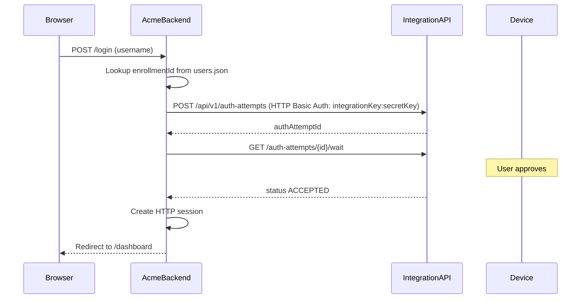

# Ezkey Demo App ACME

Demo application showcasing Ezkey passwordless login integration with backend-side authentication.

## Quick Start

### Docker (Recommended)

```bash
# From repo root
./docker/start.sh
# Access: http://localhost:8082

# API key credentials: set via config or use "Configure API Key" dialog on login page
export EZKEY_INTEGRATION_KEY=ezkey_ikey_xxx
export EZKEY_SECRET_KEY=ezkey_skey_xxx

# Ensure users mapping file exists:
# data/acme-users.json
```

For the internet-facing demo mode, the login page also supports entering the integration key and
secret interactively. Those credentials are stored only for the current browser session and can be
reused across multiple login/logout cycles in that same session.

### IDE / Local

```bash
cd ezkey-demo-app-acme
mvn spring-boot:run
# Requires Integration API reachable (default http://localhost:7080 — map ezkey.admin-api-url if different)
# Requires EZKEY_INTEGRATION_KEY and EZKEY_SECRET_KEY environment variables
# Requires data/acme-users.json file
```

## URLs

| Service | URL |
|---------|-----|
| Demo App | http://localhost:8082 |
| Login Page | http://localhost:8082/login |
| Dashboard | http://localhost:8082/dashboard |

## Login Flow



## Configuration

### External Configuration Override

Spring Boot supports external configuration files that override JAR-internal properties:

- **Docker**: Place `application.properties` in `/app/config/` (mounted volume)
- **Local**: Place `application.properties` in `./config/` directory next to the JAR

Actuator lives on the **management** port (**8086** locally / in Docker), not on business 8082.
Health example:

```bash
curl -f http://127.0.0.1:8086/actuator/health
```

(`refresh` is not exposed in the default Acme Actuator set.)

### Configuration Properties

| Property | Default | Description |
|----------|---------|-------------|
| `ezkey.admin-api-url` | `http://localhost:7080` | Ezkey SDK base URL — **Integration API** (`http://integration-api:7080` in Docker Compose). Legacy env: `EZKEY_ADMIN_API_URL`. |
| `ezkey.integration.key` | (required) | Integration key for API key authentication (e.g., `ezkey_ikey_xxx`) |
| `ezkey.secret.key` | (required) | Secret key for API key authentication (e.g., `ezkey_skey_xxx`) |
| `ezkey.users.file` | `data/acme-users.json` | Path to users mapping file |
| `ezkey.users.file.check-interval` | `5` | Hot-reload check interval in seconds (0 to disable) |

**Authentication Format**: `Authorization: Basic base64(integrationKey:secretKey)`

## Temporary Access Codes / Tenant Aliases (Play closed testing)

Optional multi-tenant slots for evaluator links. **Community preferred path (#958):** append a line to
the hot-reloaded file `/app/config/tenant-aliases.properties` (no restart). Full Edgar runbook:
[`docs/lightsail/community/acme-tenant-alias-runbook.md`](../docs/lightsail/community/acme-tenant-alias-runbook.md).

### Hot-reloaded external file (community)

1. **Generate an alias** (16 lowercase hex — UUID v4 without dashes, first 16 chars):

   ```bash
   python3 -c "import uuid; print(uuid.uuid4().hex[:16])"
   ```

2. **Append** one line to `/app/config/tenant-aliases.properties` (temp file + `mv`, as user `spring`):

   ```text
   <alias>|<integration-key>|<secret-key>|<label>
   ```

3. **No restart.** The next `GET /t/{alias}` checks mtime (throttled) and reloads if the file changed.

4. **Tester URL:** `https://demo-acme.ezkey.online/t/{alias}` (local: `http://localhost:8082/t/{alias}`).
   Unknown and malformed aliases get the same generic sign-in page (no oracle). Per-IP rate limit
   applies. Never log the full alias or secret.

5. **Revoke:** remove the line (same atomic write) — takes effect on the next URL access after throttle.

6. **File permissions:** mode `0600`, owner `spring` (uid `100` / gid `101`). Entrypoint creates the
   empty file and `chmod 600` on every start.

### Base slots in application.properties (restart required)

Still supported for local/dev. Edit `ezkey.access-codes.<slot>.*` then restart the container
(fail-fast if a code is malformed or duplicated). Prefer the external file on the community host.

Never commit real access codes, aliases, or personal tester data.

## Rate limiting (QA notes)

Acme enforces its own Bucket4j limits from `application.properties` (`ezkey.rate-limit.*`).
See also [`CONFIGURATION.md`](CONFIGURATION.md).

| Surface | Buckets | Default ceiling |
|---------|---------|-----------------|
| `GET /t/{code}` (any code) | IP-only `login.*` first; valid codes also consume slot+IP | **20 / 5 min per IP across all codes** |
| `POST /login` with slot in session | slot+IP `login.*` **plus** wider per-IP `login-ip-bound.*` | **20 / 5 min per slot+IP** and **60 / 5 min per IP** |
| `POST /login` self-service (no slot) | IP-only `login.*` | **20 / 5 min per IP** |
| `GET /api/auth-status` | none | n/a |

`/t` is intentionally **not** isolated per slot: every activation (valid or invalid) burns the shared
IP-only budget so exhausting it with guesses cannot be bypassed by a fresh slot+IP key (anti-oracle).
Slot isolation applies to **login retries** after a slot is in session, with the wider
`login-ip-bound` capping aggregate slot-mode logins from one NAT IP.

Guessing codes never gets a more generous allowance. Rate-limit UI copy is identical for valid and
invalid `/t` responses. Apply-api-key is a separate bucket (5 / 10 min). Limits are **on by default**
on a normal clean-start / Docker stack.

Community / Lightsail overlay: `demo-app-acme-config` (`/app/config/application.properties`) or env
`EZKEY_RATE_LIMIT_LOGIN_REQUESTS` / `EZKEY_RATE_LIMIT_LOGIN_IP_BOUND_REQUESTS`, then recreate
`demo-app-acme`.

Exhausting a bucket does **not** return HTTP 429 from browser login/`/t` entry points: `GET /t/{code}`
responds **200** with the generic rate-limit message, and `POST /login` responds **302** to
`/login?error=ratelimited`. Wait for the window or use another IP / slot.

## Demo Session Model

- API key credentials entered in the UI are scoped to the current browser session only.
- Logging out clears the authenticated demo user and pending auth flow state, but keeps the demo
  API key available for the next login attempt in that same browser session.
- A different browser or browser profile does not inherit another session's demo API key.
- Session expiry or losing the browser session can require re-entering the API key.
- Access-code activation and pasted API keys each invalidate the previous session before storing the
  new credential source.

## Users Mapping File

Create `data/acme-users.json`:

```json
{
  "users": [
    {
      "username": "alice",
      "enrollmentId": 1,
      "displayName": "Alice Demo"
    },
    {
      "username": "bob",
      "enrollmentId": 2,
      "displayName": "Bob Test"
    }
  ]
}
```

The file is hot-reloadable - changes are detected and reloaded automatically (if `check-interval > 0`).

## Key Files

- `controller/LoginController.java` - Handles POST `/login`, coordinates auth flow
- `controller/HomeController.java` - Routes for dashboard/logout
- `config/EzkeyClientProvider.java` - Supplies EzkeyClient from current credentials
- `service/DemoApiKeyConfigService.java` - API key holder with runtime override support
- `service/UserMappingService.java` - Users file loader with hot-reload
- `config/EzkeyClientConfig.java` - Spring configuration
- `templates/login.html` - Login page with "Configure API Key" dialog
- `templates/dashboard.html` - Post-login dashboard

## Architecture

- **Backend-side authentication**: Server calls Admin API using API key (machine-to-machine) authentication
- **HTTP session**: Secure server-side session management
- **Session-scoped demo credentials**: API keys entered in the UI are isolated per browser session
- **User mapping**: External JSON file maps usernames to enrollment IDs
- **Hot-reload**: Users file changes detected and reloaded automatically

## Prerequisites

1. **API Key Credentials**: Must be created via Admin API for the ACME integration:
   - `integrationKey`: Public key (e.g., `ezkey_ikey_xxx`) - used as HTTP Basic Auth username
   - `secretKey`: Secret key (e.g., `ezkey_skey_xxx`) - used as HTTP Basic Auth password
   - Set via `EZKEY_INTEGRATION_KEY` and `EZKEY_SECRET_KEY` env vars, config file, or **"Configure API Key" dialog** on login page (no restart)
2. **Users File**: Automatically created by bootstrap-init with `admin.docker` user (enrollmentId: 1)
3. **Enrollments**: Users must have active enrollments in the Ezkey system

## Docker Setup

The Docker stack automatically:
- Creates `acme-users.json` with `admin.docker` user via bootstrap-init
- Mounts `/app/config/` volume for external `application.properties` override
- Mounts `/app/data/` volume for `acme-users.json` file

### Editing Configuration in Docker Desktop

1. **API Keys**: Use "Configure API Key" dialog on login page (no restart), or edit `/app/config/application.properties` and restart
2. **Users Mapping**: Edit `/app/data/acme-users.json` → Auto-reloaded every 5 seconds or click "Reload Users"

## Future Enhancements

- Bootstrap-init integration to automatically create API key and seed users file
- Multiple integration support
- User self-registration flow