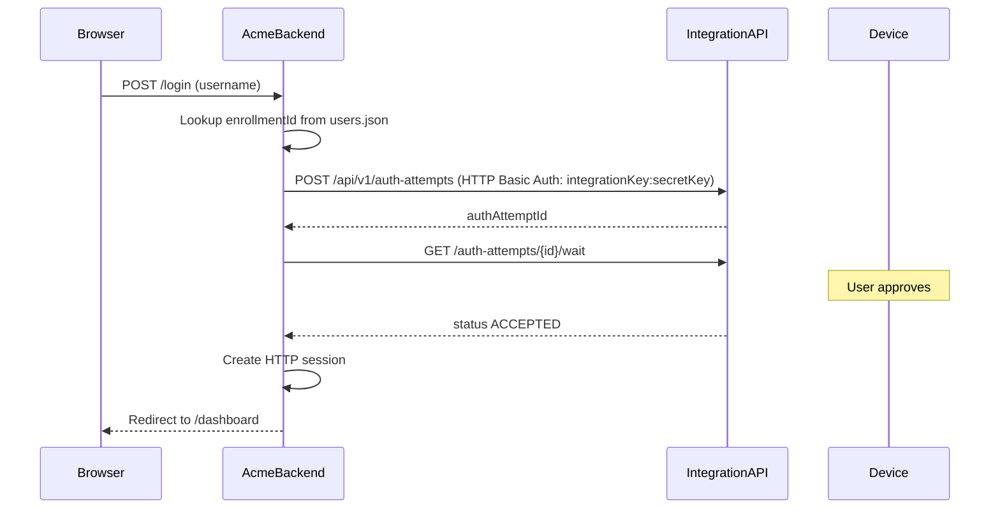

# Ezkey Demo App ACME

Demo application showcasing Ezkey passwordless login integration with backend-side authentication.

## Quick Start

### Docker (Recommended)

```bash
# From repo root
./docker/start.sh
# Access: http://localhost:8082

# API key credentials: set via config or use "Configure API Key" dialog on login page
export EZKEY_INTEGRATION_KEY=ezkey_ikey_xxx
export EZKEY_SECRET_KEY=ezkey_skey_xxx
```

For the internet-facing demo mode, the login page also supports entering the integration key and
secret interactively. Those credentials are stored only for the current browser session and can be
reused across multiple login/logout cycles in that same session.

### IDE / Local

```bash
cd ezkey-demo-app-acme
mvn spring-boot:run
# Requires Integration API reachable (default http://localhost:7080 — map ezkey.admin-api-url if different)
# Requires EZKEY_INTEGRATION_KEY and EZKEY_SECRET_KEY (or an access-code slot / Configure API Key dialog)
```

## URLs

| Service | URL |
|---------|-----|
| Demo App | http://localhost:8082 |
| Login Page | http://localhost:8082/login |
| Dashboard | http://localhost:8082/dashboard |

## Login Flow



## Configuration

### External Configuration Override

Spring Boot supports external configuration files that override JAR-internal properties:

- **Docker**: Place `application.properties` in `/app/config/` (mounted volume)
- **Local**: Place `application.properties` in `./config/` directory next to the JAR

Actuator lives on the **management** port (**8086** locally / in Docker), not on business 8082.
Health example:

```bash
curl -f http://127.0.0.1:8086/actuator/health
```

(`refresh` is not exposed in the default Acme Actuator set.)

### Configuration Properties

| Property | Default | Description |
|----------|---------|-------------|
| `ezkey.admin-api-url` | `http://localhost:7080` | Ezkey SDK base URL — **Integration API** (`http://integration-api:7080` in Docker Compose). Legacy env: `EZKEY_ADMIN_API_URL`. |
| `ezkey.integration-key` | (optional) | Integration key for API key authentication (e.g., `ezkey_ikey_xxx`). Env: `EZKEY_INTEGRATION_KEY`. |
| `ezkey.secret-key` | (optional) | Secret key for API key authentication (e.g., `ezkey_skey_xxx`). Env: `EZKEY_SECRET_KEY`. |
| `ezkey.access-codes.<slot>.*` | (none) | Multi-tenant evaluator slots — see below / [`CONFIGURATION.md`](CONFIGURATION.md). |

**Authentication Format**: `Authorization: Basic base64(integrationKey:secretKey)`

Login resolves the username via Integration API `createAuthAttemptByUserIdentifier` (no local
username→enrollmentId mapping service).

## Temporary Access Codes (Play closed testing)

Optional multi-tenant slots for evaluator links. Config is already external on volume
`demo-app-acme-config` (`/app/config/application.properties`). **Restart required** after edit
(slots load at JVM start). Community operator runbook:
[`docs/lightsail/acme-access-code-runbook.md`](../docs/lightsail/acme-access-code-runbook.md).

1. **Generate a code** (32 lowercase hex chars):

   ```bash
   openssl rand -hex 16
   ```

2. **Edit** `/app/config/application.properties` (Docker volume) or the local external config file:

   ```properties
   ezkey.access-codes.northwind.code=<openssl-rand-hex-16>
   ezkey.access-codes.northwind.integration-key=ezkey_ikey_…
   ezkey.access-codes.northwind.secret-key=ezkey_skey_…
   ezkey.access-codes.northwind.label=Northwind Portal
   ```

3. **Restart** the demo container so slots load (fail-fast if a code is malformed or duplicated).
   Local compose: `docker restart ezkey-demo-app-acme`. Community: `ezkey-exp-demo-app-acme`.

4. **Tester URL:** `/t/{code}` on the Acme surface (local: `http://localhost:8082/t/{code}`).
   Unknown codes show the generic sign-in error (no session cookie on that link-lost page).

5. **Revoke:** remove or rotate the slot (delete the `ezkey.access-codes.<slot>.*` block, or change `.code`) and restart.

6. **File permissions:** the image runs as `spring` (uid `100` / gid `101`). Config should be mode `0600`. The entrypoint applies `chmod 600` on every start; if that fails (e.g. root-owned volume file), it prints a WARN — fix ownership on the host volume.

Never commit real access codes or personal tester data. See `config/application.properties.example` for the slot shape.

## Rate limiting (QA notes)

Acme enforces its own Bucket4j limits from `application.properties` (`ezkey.rate-limit.*`).
See also [`CONFIGURATION.md`](CONFIGURATION.md).

| Surface | Buckets | Default ceiling |
|---------|---------|-----------------|
| `GET /t/{code}` (any code) | IP-only `login.*` first; valid codes also consume slot+IP | **20 / 5 min per IP across all codes** |
| `POST /login` with slot in session | slot+IP `login.*` **plus** wider per-IP `login-ip-bound.*` | **20 / 5 min per slot+IP** and **60 / 5 min per IP** |
| `POST /login` self-service (no slot) | IP-only `login.*` | **20 / 5 min per IP** |
| `GET /api/auth-status` | none | n/a |

`/t` is intentionally **not** isolated per slot: every activation (valid or invalid) burns the shared
IP-only budget so exhausting it with guesses cannot be bypassed by a fresh slot+IP key (anti-oracle).
Slot isolation applies to **login retries** after a slot is in session, with the wider
`login-ip-bound` capping aggregate slot-mode logins from one NAT IP.

Guessing codes never gets a more generous allowance. Rate-limit UI copy is identical for valid and
invalid `/t` responses. Apply-api-key is a separate bucket (5 / 10 min). Limits are **on by default**
on a normal clean-start / Docker stack.

Community / Lightsail overlay: `demo-app-acme-config` (`/app/config/application.properties`) or env
`EZKEY_RATE_LIMIT_LOGIN_REQUESTS` / `EZKEY_RATE_LIMIT_LOGIN_IP_BOUND_REQUESTS`, then recreate
`demo-app-acme`.

Exhausting a bucket does **not** return HTTP 429 from browser login/`/t` entry points: `GET /t/{code}`
responds **200** with the generic rate-limit message, and `POST /login` responds **302** to
`/login?error=ratelimited`. Wait for the window or use another IP / slot.

## Demo Session Model

- API key credentials entered in the UI are scoped to the current browser session only.
- Logging out clears the authenticated demo user and pending auth flow state, but keeps the demo
  API key available for the next login attempt in that same browser session.
- A different browser or browser profile does not inherit another session's demo API key.
- Session expiry or losing the browser session can require re-entering the API key.
- Access-code activation and pasted API keys each invalidate the previous session before storing the
  new credential source.

## Key Files

- `controller/LoginController.java` - Handles POST `/login`, coordinates auth flow
- `controller/HomeController.java` - Routes for dashboard/logout
- `controller/AccessCodeController.java` - `GET /t/{code}` evaluator entry
- `config/EzkeyClientProvider.java` - Supplies EzkeyClient from current credentials
- `service/DemoApiKeyConfigService.java` - Session-scoped API key / access-code slot resolution
- `service/AccessCodeService.java` - Access-code slot load + digest lookup (startup fail-fast)
- `config/EzkeyClientConfig.java` - Spring configuration
- `templates/login.html` - Login page with "Configure API Key" dialog
- `templates/dashboard.html` - Post-login dashboard

## Architecture

- **Backend-side authentication**: Server calls Integration API using API key (machine-to-machine)
- **HTTP session**: Secure server-side session management
- **Session-scoped demo credentials**: API keys entered in the UI are isolated per browser session
- **Username**: passed to Integration API as `user_identifier` (no local UserMappingService)

## Prerequisites

1. **API Key Credentials**: Must be created via Admin API for the ACME integration (or per-tenant
   keys in an access-code slot):
   - `integrationKey`: Public key (e.g., `ezkey_ikey_xxx`) - used as HTTP Basic Auth username
   - `secretKey`: Secret key (e.g., `ezkey_skey_xxx`) - used as HTTP Basic Auth password
   - Set via `EZKEY_INTEGRATION_KEY` / `EZKEY_SECRET_KEY`, `/app/config/application.properties`,
     access-code slot, or **"Configure API Key" dialog** on login page (session only, no restart)
2. **Enrollments**: Users must have active enrollments for the integration behind those keys

## Docker Setup

The Docker stack mounts `/app/config/` (volume `demo-app-acme-config`) for external
`application.properties` override. Entrypoint applies `chmod 600` on every start.

### Editing Configuration in Docker Desktop

1. **API Keys (session)**: Use "Configure API Key" dialog on login page (no restart)
2. **API Keys / access-code slots (persisted)**: Edit `/app/config/application.properties` and
   **restart** the container (`ezkey-demo-app-acme` locally; `ezkey-exp-demo-app-acme` on community)

## Future Enhancements

- Bootstrap-init integration to automatically create API key and seed users file
- Multiple integration support
- User self-registration flow