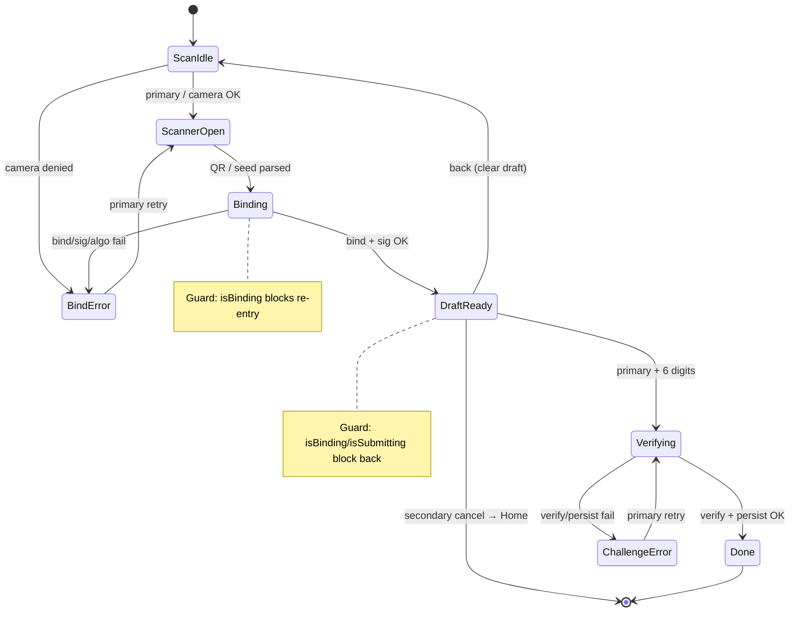
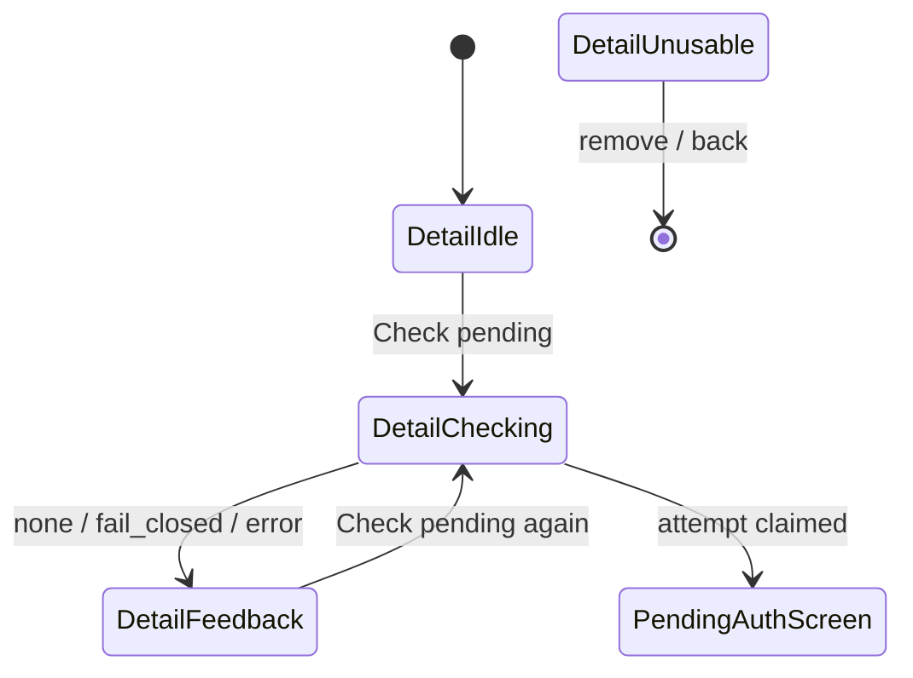
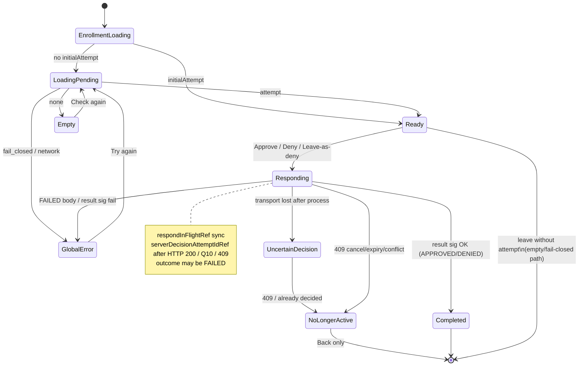

<!--
  Ezkey - Open Source Cryptographic MFA Platform
  Copyright (c) 2026 Ezkey contributors
  Licensed under the MIT License. See LICENSE file in the project root for full license information.
-->

# Ezkey Mobile — Application State Machine (canonical)

## Purpose

This document is the **canonical finite-state model** of the React Native reference app’s
decision points: enrollment (QR → bind → verify), pending-auth claim, approve/deny, leaving
`PendingAuthScreen`, errors, locks, TTL, and re-entry / duplicate-tap guards.

It is derived from **actual code** (file:line citations). It is a **descriptive** model of the
current hooks, React state, and refs — **not** an implemented FSM library or single `phase`
enum in the app (see [MOBILE_APP_STRATEGIC_ORIENTATION.md](MOBILE_APP_STRATEGIC_ORIENTATION.md)).

Protocol wire formats and Auth API contracts remain canonical in root docs (`docs/ENDPOINT.md`,
`docs/CRYPTO.md`, signature payload docs). Operational flow narration lives in
[MOBILE_FUNCTIONAL_FLOWS.md](MOBILE_FUNCTIONAL_FLOWS.md); screen inventory in
[MOBILE_SCREENS_AND_WIREFLOWS.md](MOBILE_SCREENS_AND_WIREFLOWS.md). **When behavior and those docs
disagree, this FSM + the cited code win until the owning docs are updated.**

Interactive complement (optional): [mobile-app-state-machine.html](mobile-app-state-machine.html)
(self-contained; no CDN).

## Baseline (`main` after #833)

| Baseline | Meaning |
| --- | --- |
| **Code truth for leave-as-deny / race guards** | PR [#833](https://github.com/mgagp/ezkey/pull/833) **merged 2026-10-16** onto `main`. Leave-as-deny and race guards are on `main`. |
| **Enrollment / claim / respond (shared)** | Auth API `pending` / `respond`; no mobile protocol surface change from #833. |
| **#833 mobile behavior (now on `main`)** | Leaving `PendingAuthScreen` with a loaded attempt → Auth API `respond(accepted=false)` (same as Deny). Guards: `serverDecisionAttemptIdRef` (per `authAttemptId`), `respondInFlightRef` / `isRespondInFlight`. Backend approve/deny uses conditional `UPDATE … WHERE status = READ`; cancel uses `expireIfPendingOrRead`. |

**This document describes current `main` behavior** (post-#833). Abandoned loaded attempts are
refused via leave-as-deny rather than waiting for TTL. Admin
`POST /api/v1/admin/auth/passwordless-cancel` is **not** used by mobile.

Decision (repo-as-memory): Leave-with-loaded-attempt is Deny via Auth API respond, not cancel and
not TTL-wait — reason: unblock Admin passwordless-wait when the user abandons the phone screen;
issue [#834](https://github.com/mgagp/ezkey/issues/834) / PR #833. The leave line, the single
“no longer active” sentence, and the other confirmed honesty items are locked in the orientation
note (Questions 5, 6, and 8). Application-independent rules:
[`docs/CLIENT_BEHAVIOUR_CONTRACT.md`](../../docs/CLIENT_BEHAVIOUR_CONTRACT.md).

---

## Notation

| Symbol | Meaning |
| --- | --- |
| **State** | Named UI/logic mode the user or hook is in (not necessarily a single `enum`). |
| **Event** | User action, navigation event, or async completion. |
| **Guard** | Condition that must hold for the transition (or that blocks it). |
| **Effect** | Side effect: Auth API call, crypto, local storage, navigation. |
| **TTL** | Three numbers: per-request floor **15**; hard ceiling **120** (`min(request\|default, 120)` since #895); property `ezkey.core.auth-attempt.ttl-seconds` default **120** (Bean Validation **30–600**, startup clamp **>120 → 120**, so effective configured default **30–120**). “120 seconds” means that default / ceiling. |

Server auth-attempt statuses (backend): `PENDING` → (device claims) `READ` → `ACCEPTED` |
`REJECTED` | `INVALID` | `EXPIRED`. Mobile does not model those as local enums; it holds an
in-memory `PendingAttempt` or not.

---

## 1. Enrollment wizard FSM (QR → bind → verify)

**Owner code:** `app/hooks/useEnrollmentWizard.ts`, `app/screens/EnrollmentWizard/EnrollmentWizardScreen.tsx`.

### States

| State | How recognized in code | User sees |
| --- | --- | --- |
| `ScanIdle` | `!draft`, `!isBinding`, `!scannerVisible` | Scan CTA; optional F2a bypass in debug |
| `ScannerOpen` | `scannerVisible === true` | Camera modal |
| `Binding` | `isBinding === true` | Primary CTA “Binding…”; draft cleared for this attempt |
| `BindError` | `bindError` or `cameraError` set, still `!draft` | Error banner on scan stage |
| `DraftReady` | `draft` set, `!isSubmitting` | Verify stage: 6-digit challenge, then Cancel / Complete enrollment directly under the boxes (Complete disabled until 6 digits; #1082), then info card |
| `Verifying` | `isSubmitting === true` | Primary “Finishing…” |
| `ChallengeError` | `challengeError` set while draft may still exist | Inline challenge error |
| `Done` | Success path calls `popToTop()` after persist | Returns to Home |

### Events, guards, effects

| Event | From | To | Guard | Effect / API |
| --- | --- | --- | --- | --- |
| Tap primary (no draft) | `ScanIdle` / `BindError` | `ScannerOpen` | Camera permission granted (else `cameraError`) | Opens scanner (`handlePrimary` L452–468) |
| QR scanned / F2a seed | `ScannerOpen` | `Binding` | Parsed id + proof token; Auth URL or global base URL | `enrollmentsApi.bind` (`performBinding` L243–314) |
| Bind success + sig OK | `Binding` | `DraftReady` | `integrationKeyAlgorithm` Ed25519; bind signature verifies | In-memory `draft` only — not persisted yet (L280–308) |
| Bind fail / bad sig / algo | `Binding` | `BindError` | — | Sets `bindError`; closes scanner |
| Duplicate bind while binding | `Binding` | `Binding` | `isBinding` | Early return — no second bind (L245–247) |
| Enter 6 digits + primary | `DraftReady` | `Verifying` | Challenge length === 6 | Keystore ensure → sign → `enrollmentsApi.verify` → verify-result sig → optional signed instance-info → `saveEnrollment` → `popToTop` (L319–429) |
| Verify / persist fail | `Verifying` | `ChallengeError` | — | Deletes key pair if created; clears challenge (L420–426) |
| Secondary / cancel with draft | `DraftReady` | leave wizard | `!isBinding && !isSubmitting` | Clears draft; `popToTop` (L480–488) |
| Back with draft | `DraftReady` | `ScanIdle` | `!isBinding && !isSubmitting` | Clears draft/challenge; stays on wizard (L494–504) |
| Back without draft | `ScanIdle` | previous screen | `!isBinding && !isSubmitting` | `goBack()` (L505–506) |
| Back while binding/verifying | any | same | `isSubmitting \|\| isBinding` | **No-op** — cannot leave mid-flight (L496–498) |

### User stories (enrollment)

1. **Happy path:** As a user, I scan the Admin QR, see who I’m enrolling for, enter the 6-digit code, and land on Home with a new enrollment card.
2. **Wrong camera / missing URL:** As a user, if the QR has no Auth URL and the app has no global base URL, bind fails with a clear error and I can re-scan.
3. **Abandon after bind:** As a user, I can tap Back after a successful bind to discard the draft without persisting keys; I am not left half-enrolled.

---

## 2. Enrollment Detail → claim pending

**Owner code:** `EnrollmentDetailScreen.tsx` (`handleCheckPending`), shared
`claimPendingAttempt.ts`.

Pull model: **no background polling**. User must tap **Check pending** (or Check again on
Pending Auth).

### States (Detail)

| State | Recognition | Notes |
| --- | --- | --- |
| `DetailIdle` | Enrollment loaded, not checking | Shows identity + Check pending |
| `DetailChecking` | `isCheckingPending` | Button busy |
| `DetailFeedback` | `inlineFeedback` set | No pending / fail-closed / network message |
| `DetailUnusable` | Broken enrollment (MOB-015) | No Check pending |

### Transitions

| Event | From | To | Guard | Effect |
| --- | --- | --- | --- | --- |
| Check pending | `DetailIdle` | `DetailChecking` | Enrollment present; `!isCheckingPending` (L104–106) | Persist last-checked timestamp (best-effort); `claimPendingAttempt` |
| Claim `none` | `DetailChecking` | `DetailFeedback` | HTTP empty / 204 | Stay on Detail; “no pending” |
| Claim `fail_closed` | `DetailChecking` | `DetailFeedback` | Missing key / bad sig / malformed | **Decided ([#834](https://github.com/mgagp/ezkey/issues/834) Question 4):** stay; do not show the request. Row may stay `READ` until server expiry. No unsigned refusal, no release protocol, no audit event until a real incident. Calm copy, no signature jargon. |
| Claim `attempt` | `DetailChecking` | navigate `PendingAuth` | Signature verified | Pass `initialAttempt` in route params (L139–142) |
| Network/crypto throw | `DetailChecking` | `DetailFeedback` | — | `extractErrorMessage` |
| Double tap Check | `DetailChecking` | same | `isCheckingPending` | Early return (L104–106) |

### Claim sub-machine (`claimPendingAttempt`)

| Step | Effect |
| --- | --- |
| `start` → `after_ensure` | `requireEnrollmentKeyPair` |
| Mint + sign proof | Fresh `deviceProofToken` + device signature |
| `POST …/auth-attempts/pending` | Auth API claim (server `PENDING`→`READ` on success) |
| Empty body | `{ kind: 'none' }` |
| Verify integration sig | Fail-closed on missing key / invalid sig / malformed |
| Success | `{ kind: 'attempt', attempt }` — **no `expiresAt` stored locally** (decided: countdown stays on the integrating application; [#834](https://github.com/mgagp/ezkey/issues/834) Question 1) |

---

## 3. Pending Auth FSM (load → decide → leave)

**Owner code:** `usePendingAuth.ts`, `PendingAuthScreen.tsx` (post-#833 leave listener).

### UI / hook states (descriptive)

Implementation today is scattered React state + refs (`attempt`, `loading`, `isProcessing`,
`globalError`, `respondInFlightRef`, `serverDecisionAttemptIdRef`) — not a single FSM object.

| State | Recognition | User sees |
| --- | --- | --- |
| `EnrollmentLoading` | `isEnrollmentLoading` | Spinner |
| `LoadingPending` | `loading` | Spinner “Contacting Auth API…” |
| `Empty` | `showEmptyState` | No pending + Check again |
| `GlobalError` | `globalError` set; retryable | Error + Try again (+ optional debug panel) |
| `NoLongerActive` | **Decided** ([#834](https://github.com/mgagp/ezkey/issues/834) Question 8; wire [#844](https://github.com/mgagp/ezkey/issues/844) m1 / #833; amended #895) | One sentence: the request is no longer active (or distinct “expired” copy). **Back only**, not Try again. **409** `auth-attempt-state-conflict` covers not-found, still `PENDING`, cancelled, already decided, superseded. **409** `auth-attempt-expired` covers wall-clock expiry after ownership proof (#895). |
| `Ready` | `attempt` set, `!isProcessing` | Context card; Approve / Deny; leave-declines hint (Q5); optional 2-digit challenge. With a challenge, Approve is disabled until 2 digits (#1082) |
| `Responding` | `isProcessing` / `respondInFlightRef` | Buttons disabled; “Sending…” on approve |
| `UncertainDecision` | **Decided** ([#834](https://github.com/mgagp/ezkey/issues/834) Question 10); **delivered on #833** | After `respond` HTTP was sent: timeout / transport / undecidable. Catalog: result uncertain; check the sign-in where it was started; not a failure; Back only; lock `authAttemptId` (blocks leave-as-deny and a second decision). No idempotent respond. |
| `SigningUnavailable` | HTTP **503** `integration-signing-unavailable` (#844) | Local catalog; **retryable**. A retry **may** then return terminal **409** (for example wrong challenge already committed `INVALID` before signing failed). Not a Q8/Q10 Back-only state by itself. |
| `Completed` | After verified respond result + `setRecentAuthResult` | Navigates back to Detail |

Internal refs (#833):

| Ref | Set when | Purpose |
| --- | --- | --- |
| `serverDecisionAttemptIdRef` | After Auth API `respond` returns HTTP 200 (before local result-signature checks); also on non-retryable 409 and on Q10 UncertainDecision after HTTP started | Skip leave-as-deny and further respond (`hasSubmittedServerDecision`) when the stored id equals the current attempt. Means a respond exchange **completed or became undecidable at HTTP layer**; outcome may be `APPROVED`, `DENIED`, business **`FAILED`**, conflict, or uncertain — not “APPROVED committed.” **Delivered** per `authAttemptId` (Q13 / #833). |
| `respondInFlightRef` | Synchronously at start of `handleRespond`, cleared in `finally` | Block leave-as-deny racing an in-flight approve (`isRespondInFlight`) |

### Auto-load on mount

| Condition | Behavior | Citation (#833 / main same idea) |
| --- | --- | --- |
| `initialAttempt` present | Skip auto `loadPendingAttempt`; mark enrollment id in `autoLoadEnrollmentRef` | usePendingAuth auto-load effect |
| No `initialAttempt` | Load once per enrollment id | Same |
| Re-entry same enrollment | `autoLoadEnrollmentRef` prevents duplicate auto-load | L353–357 |

### Approve / Deny (`handleRespond`)

| Event | Guard | Effect |
| --- | --- | --- |
| Approve / Deny press | `enrollment`, `attempt`, `!hasSubmittedServerDecision()`, `!respondInFlightRef` | Else skip (duplicate / in-flight / locked id). Buttons also `disabled={isProcessing}` (UI only). |
| Approve only | If `challengeRequired`, challenge length === 2 (`AUTH_CHALLENGE_LENGTH`) | Else form error; no API. The screen also disables Approve until the length is met (#1082); the hook guard stays as the backstop |
| Deny | Challenge **not** required locally; server also skips challenge on reject | Same `respond` path with `accepted=false` |
| Protected mode | `requiresProtectedApproval` (enrollment policy **or** device preference) | **Decided ([#834](https://github.com/mgagp/ezkey/issues/834) Question 11):** biometric or device credential on **Approve only**, then `signForRespond`. Deny and leave-as-deny **SHOULD** sign without that prompt (**not yet shipped in the app code** — Deny may still prompt). |
| HTTP `respond` 200 | — | Set `serverDecisionAttemptIdRef` **before** the result-signature check (**decided**, [#834](https://github.com/mgagp/ezkey/issues/834) Question 2); on success `setRecentAuthResult` + navigate. Body outcome may be `APPROVED` / `DENIED` / **`FAILED`**. |
| Timeout / transport cut after send (no HTTP response) | — | **`UncertainDecision` (Q10):** lock id; Back only; no leave-as-deny. HTTP **400**/**429** with a body keep catalog retryability (not UncertainDecision). Pre-send failures (e.g. biometric cancel) stay retryable without lock. **503** `integration-signing-unavailable` stays catalog-retryable (#844); a retry may return terminal **409**. Try again dismisses error and keeps the loaded attempt (does not re-claim pending → empty). Ambiguous other **5xx** after send: contract **SHOULD** treat as UNKNOWN (extension of Q10; not yet locked in app/SDK). |
| Result sig fail after HTTP 200 | — | **Decided (Questions 2 and 9):** stay; do not display approved or denied; hide Approve/Deny; leave will **not** re-deny. Sentence: response sent, confirmation could not be verified, check the sign-in where it was started. No tenant name. Back only. |
| Buttons while processing | `disabled={isProcessing}` | UI lock; refs close the sync gap before re-render |

API: `POST /api/v1/auth-attempts/respond` (Auth API). **Not** Admin cancel / passwordless-cancel.
Problem types: `…/auth-attempt-state-conflict` (**409**) for not-found / PENDING / terminal /
cancelled / superseded / non-owner signature; `…/auth-attempt-expired` (**409**) for wall-clock
expiry after ownership proof (#895). **Decided (Question 8 + #844 m1; amended #895):** mobile shows
“no longer active” (and **MAY** use distinct expired copy for `auth-attempt-expired`) and Back only.
It does not split `auth-attempt-state-conflict` into multiple causes. **503**
`integration-signing-unavailable` is a separate retryable catalog path (retry may then hit
terminal 409).

### Leave screen (post-#833 on `main`) — critical

`navigation.addListener('beforeRemove')` on `PendingAuthScreen`:

| Condition | Behavior |
| --- | --- |
| No `attempt` (empty / error / still loading / fail-closed) | Allow leave; **no** respond — server may still be `READ` until TTL |
| `isProcessing` or `isRespondInFlight()` or `hasSubmittedServerDecision()` | Allow leave; **no** second deny (in-flight success may still `goBack` → double pop risk) |
| Else (`Ready` with loaded attempt) | `preventDefault` → `handleRespond(false)` (identical Deny). **Decided (Question 11):** no biometric prompt (**not yet shipped in the app code**). |
| Deny succeeds | Hook already navigates via `handleReturnToEnrollmentDetail` |
| Deny fails (network) | **Decided ([#834](https://github.com/mgagp/ezkey/issues/834) Question 3):** still leave (do not trap). One short message. No automatic retry. The person checks the integrating application: refusal arrived, or the countdown is still running and they let it finish or cancel there. |
| Deny HTTP 200 then result-sig fail | User **stays** on screen (leave is not dispatched) |

**Historical:** before #833 merged (2026-10-16), leave did not call respond; attempt stayed
`READ`/`PENDING` until TTL.

**Decided ([#834](https://github.com/mgagp/ezkey/issues/834) Question 5):** while a request is
loaded, a permanent line under Approve and Deny says that leaving this screen declines the request.
No confirmation dialog. Marc confirmed on a live approval screen that the layout has room and the
line stays readable.

### Missing / edge transitions (document as limits)

| Edge | Behavior today |
| --- | --- |
| New attempt on same screen after lock | **Decided ([#834](https://github.com/mgagp/ezkey/issues/834) Question 13); delivered on #833:** `serverDecisionAttemptIdRef` stores the attempt id. A new pending attempt with a different id is not locked. A later 409 uses the Question 8 sentence, not a new “already decided” line. |
| Lost response after server processed | **Decided (Question 10); delivered on #833:** uncertain sentence pointing at the sign-in screen. Not a failure. No retry that sends another decision. Lock blocks leave-as-deny. Idempotent `respond` deferred, not specified. |
| App killed / background during respond or Approve biometric | **Decided ([#834](https://github.com/mgagp/ezkey/issues/834) Question 12):** `beforeRemove` may not run → no leave-deny → `READ` until applied lifetime (per-request **15–120**; configured default effective **30–120**; ceiling **120**). Accepted limit. No release protocol unless a real incident requires it. |
| Lifetime ends during Approve biometric | Later respond → **409**, Question 8 sentence. Same accepted limit. |

### Timers / TTL

| Layer | Behavior |
| --- | --- |
| Server | Attempt `expiresAt` from applied TTL (per-request floor **15**, ceiling **120** since #895; property default **120**, Bean Validation **30–600**, startup clamp to 120 → effective configured default **30–120**). Scheduler marks `EXPIRED`. Cloudflare Free on the public hosts cuts the origin at **100 s** (HTTP 524); a blocking wait can end at the proxy while a 120 s attempt is still valid. Deployment note for the community instance (Question 12). Not changed here. |
| Mobile pending wire | **No** `expiresAt`, `expiresInSeconds`, or `serverNow` on the pending body. **Decided ([#834](https://github.com/mgagp/ezkey/issues/834) Questions 1 and 14):** do not add them, unsigned or inside the signed payload. |
| Mobile UI | **No countdown, by design.** The person watches remaining time on the integrating application (create/wait `expiresAt`). A second timer on the phone would duplicate that clock and drift. No countdown on mobile: the initiator watches the integrating app's login dialog, which owns the timer; a second timer would be redundant and drift (team retro 2026-10-19). |
| Respond after server expiry | **Decided (Question 8 + #844 m1; amended #895):** **409** `auth-attempt-expired` after ownership proof. Other inactive causes stay **409** `auth-attempt-state-conflict`. Back only; **MAY** use distinct expired copy. |

### Backend race (#833, context for mobile)

| Path | Mechanism | Mobile impact |
| --- | --- | --- |
| Approve/deny | `updateStatusIfCurrent(id, READ → ACCEPTED\|REJECTED)`; 0 rows → `AuthAttemptStateConflictException` → HTTP **409** + problem type above | **Decided (Question 8):** one “no longer active” sentence, Back only. Do not split types. |
| Admin / Integration cancel | `expireIfPendingOrRead(PENDING\|READ → EXPIRED)` | Mobile respond gets 409 / conflict |
| Admin passwordless-cancel | Admin API only | Not used by mobile |

### User stories (pending auth)

1. **Approve:** As a user, I open Check pending, see the request context, enter the 2-digit code if asked, approve (with biometric if protected), and return to Detail with an “approved” summary.
2. **Deny button:** As a user, I tap Deny and the waiting Admin login unblocks as rejected without needing TTL.
3. **Leave as deny (post-#833):** As a user, I swipe back / hardware back with a loaded request; the app sends the same Deny respond so I do not leave the server waiting until TTL.
4. **Double tap:** As a user, rapid Approve taps do not send two responds (`respondInFlightRef` / `isProcessing` / `serverDecisionAttemptIdRef`).
5. **Leave during approve:** As a user, if I leave while approve is in flight, the app does **not** send a competing deny; the in-flight respond continues.

---

## 4. Cross-cutting locks and re-entry

| Concern | Mechanism | Location |
| --- | --- | --- |
| Enrollment bind re-entry | `isBinding` early return | useEnrollmentWizard `performBinding` |
| Enrollment verify re-entry | `isSubmitting`; back no-op | `finalizeEnrollment` / `handleBack` |
| Detail check re-entry | `isCheckingPending` | EnrollmentDetailScreen |
| Pending load | `loading` UI; auto-load once per enrollment | usePendingAuth |
| Respond re-entry | `isProcessing` + refs (#833) | `handleRespond` |
| Leave vs approve race | `respondInFlightRef` set before any `await` | #833 m2 |
| Second deny after respond HTTP 200 | `serverDecisionAttemptIdRef` (per `authAttemptId`, **delivered** Q13 / #833) | #833 / #831 |
| Uncertain after timeout / disconnect | Lock id + Q10 catalog; leave-as-deny skipped | #833 / #844 |
| Unusable enrollment | No Check pending | MOB-015 Detail / Home |
| Protected approve **only** (**Q11** decided; **not yet shipped in the app code**) | Local biometric / device-credential before `signForRespond` on **Approve** when policy/preference requires; Deny and leave-as-deny **SHOULD** sign without that prompt (app may still prompt on Deny — code follow-up). | `requiresProtectedApproval` |

---

## 5. API side-effect map (mobile)

| Mobile action | HTTP | Notes |
| --- | --- | --- |
| Bind | `POST /api/v1/enrollments/bind` | Per-enrollment or QR `authUrl` |
| Verify | `POST /api/v1/enrollments/verify` | Then optional signed `instance-info` |
| Claim pending | `POST /api/v1/auth-attempts/pending` | Pull; read-once claim |
| Approve | `POST /api/v1/auth-attempts/respond` `accepted=true` | Challenge when required |
| Deny / leave-as-deny | Same respond `accepted=false` | Post-#833 leave path |
| — | **Not called:** `…/auth-attempts/{id}/cancel` | Admin/Integration cancel |
| — | **Not called:** `POST /api/v1/admin/auth/passwordless-cancel` | Admin UI only (#833) |

---

## 6. Open questions (code vs intent)

Full analysis, phased roadmap, collaborator reviews, and the consolidated **Questions for Marc**
list: [MOBILE_APP_STRATEGIC_ORIENTATION.md](MOBILE_APP_STRATEGIC_ORIENTATION.md).

Do **not** treat orientation proposals as locked behavior here until Marc decides; then record
one-line decisions in this FSM / `MOBILE_FUNCTIONAL_FLOWS.md`, and 409 / pending-expiry wire
semantics in `docs/ENDPOINT.md`.

---

## Related documents

| Doc | Role |
| --- | --- |
| [MOBILE_APP_STRATEGIC_ORIENTATION.md](MOBILE_APP_STRATEGIC_ORIENTATION.md) | Intent + phased backlog from §6 open questions |
| [MOBILE_FUNCTIONAL_FLOWS.md](MOBILE_FUNCTIONAL_FLOWS.md) | End-to-end nominal/exception narration |
| [MOBILE_SCREENS_AND_WIREFLOWS.md](MOBILE_SCREENS_AND_WIREFLOWS.md) | Screen inventory and wireflows |
| [MOBILE_API_MAPPINGS.md](MOBILE_API_MAPPINGS.md) | Field-level Auth API mapping |
| [../../docs/ENDPOINT.md](../../docs/ENDPOINT.md) | Auth attempt TTL, cancel, wait |
| [../../docs/features/AUTH_SECURITY.md](../../docs/features/AUTH_SECURITY.md) | Pull model / read-once |
| [mobile-app-state-machine.html](mobile-app-state-machine.html) | Clickable visual complement |

## Provenance

- GitHub issue: [#834](https://github.com/mgagp/ezkey/issues/834)
- Leave-as-deny / race guards: PR [#833](https://github.com/mgagp/ezkey/pull/833) **merged 2026-10-16**
- Applied TTL floor/ceiling: #895 (15–120 s clamp)
- Client behaviour contract: [`docs/CLIENT_BEHAVIOUR_CONTRACT.md`](../../docs/CLIENT_BEHAVIOUR_CONTRACT.md)
- Corpus consistency: [#1052](https://github.com/mgagp/ezkey/issues/1052)
- Line citations for leave/respond guards refer to `main` `usePendingAuth.ts` /
  `PendingAuthScreen.tsx` and `AuthAttemptRespondService.java` / `AuthAttemptService.cancel`
