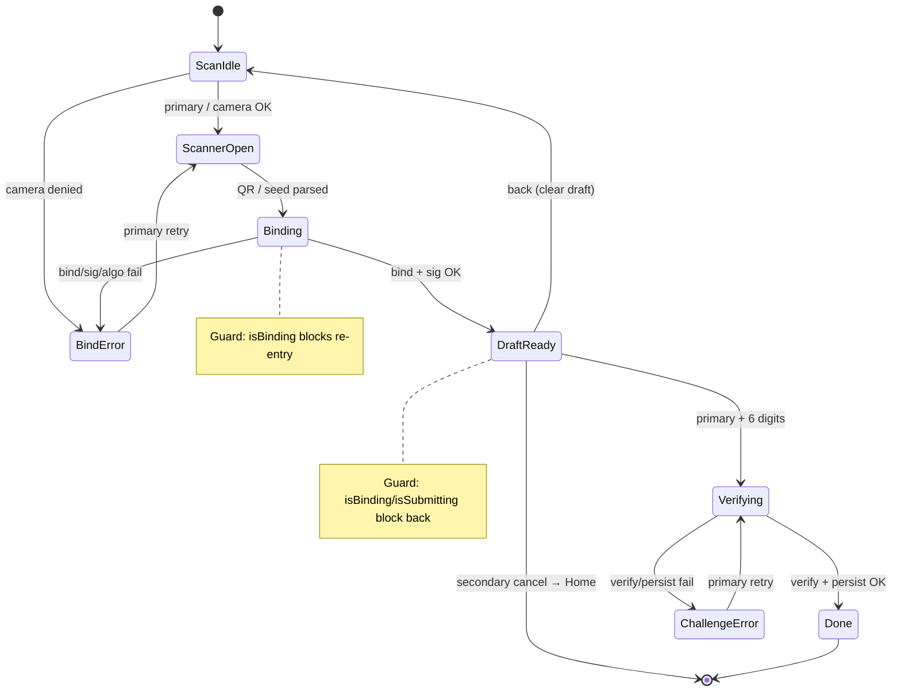
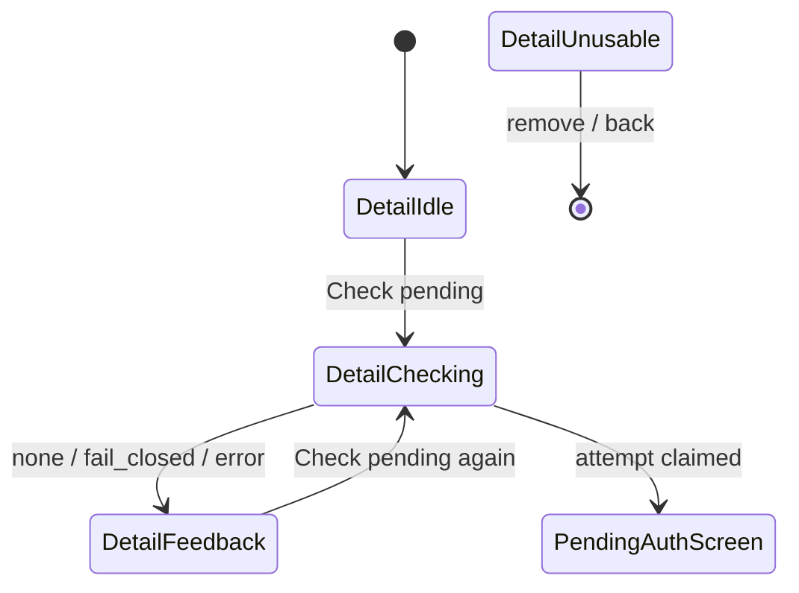
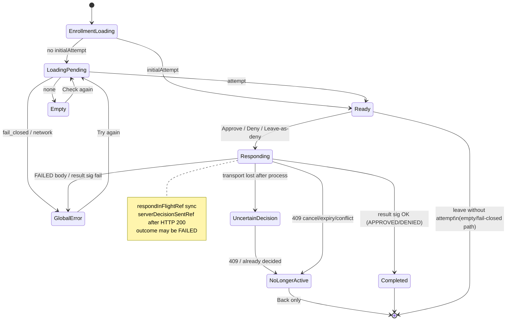

<!--
  Ezkey - Open Source Cryptographic MFA Platform
  Copyright (c) 2026 Ezkey contributors
  Licensed under the MIT License. See LICENSE file in the project root for full license information.
-->

# Ezkey Mobile — Application State Machine (canonical)

## Purpose

This document is the **canonical finite-state model** of the React Native reference app’s
decision points: enrollment (QR → bind → verify), pending-auth claim, approve/deny, leaving
`PendingAuthScreen`, errors, locks, TTL, and re-entry / duplicate-tap guards.

It is derived from **actual code** (file:line citations). It is a **descriptive** model of the
current hooks, React state, and refs — **not** an implemented FSM library or single `phase`
enum in the app (see [MOBILE_APP_STRATEGIC_ORIENTATION.md](MOBILE_APP_STRATEGIC_ORIENTATION.md)).

Protocol wire formats and Auth API contracts remain canonical in root docs (`docs/ENDPOINT.md`,
`docs/CRYPTO.md`, signature payload docs). Operational flow narration lives in
[MOBILE_FUNCTIONAL_FLOWS.md](MOBILE_FUNCTIONAL_FLOWS.md); screen inventory in
[MOBILE_SCREENS_AND_WIREFLOWS.md](MOBILE_SCREENS_AND_WIREFLOWS.md). **When behavior and those docs
disagree, this FSM + the cited code win until the owning docs are updated.**

Interactive complement (optional): [mobile-app-state-machine.html](mobile-app-state-machine.html)
(self-contained; no CDN).

## Baseline (#833 branch)

| Baseline | Meaning |
| --- | --- |
| **Code truth for leave-as-deny / race guards** | PR [#833](https://github.com/mgagp/ezkey/pull/833) branch tip **`fcc31fbf`** (not yet merged to `main`; not an ancestor of `main`). |
| **Enrollment / claim / respond (shared)** | Same Auth API `pending` / `respond` on main and #833; no mobile protocol surface change. |
| **#833 mobile behavior** | Leaving `PendingAuthScreen` with a loaded attempt → Auth API `respond(accepted=false)` (same as Deny). Guards: `serverDecisionSentRef`, `respondInFlightRef` / `isRespondInFlight`. Backend approve/deny uses conditional `UPDATE … WHERE status = READ`; cancel uses `expireIfPendingOrRead`. |

**This document describes behavior on the #833 branch @ `fcc31fbf`.** Until #833 merges, `main`
still leaves abandoned attempts `PENDING`/`READ` until TTL. Admin
`POST /api/v1/admin/auth/passwordless-cancel` is **not** used by mobile.

Decision (repo-as-memory): Leave-with-loaded-attempt is Deny via Auth API respond, not cancel and
not TTL-wait — reason: unblock Admin passwordless-wait when the user abandons the phone screen;
issue [#834](https://github.com/mgagp/ezkey/issues/834) / PR #833. (Further UX honesty — visible
leave hint, copy, `NoLongerActive` — is proposed in the orientation note; **not locked** until Marc
decides.)

---

## Notation

| Symbol | Meaning |
| --- | --- |
| **State** | Named UI/logic mode the user or hook is in (not necessarily a single `enum`). |
| **Event** | User action, navigation event, or async completion. |
| **Guard** | Condition that must hold for the transition (or that blocks it). |
| **Effect** | Side effect: Auth API call, crypto, local storage, navigation. |
| **TTL** | Server auth-attempt lifetime (`ezkey.core.auth-attempt.ttl-seconds`, default **120 s**). |

Server auth-attempt statuses (backend): `PENDING` → (device claims) `READ` → `ACCEPTED` |
`REJECTED` | `INVALID` | `EXPIRED`. Mobile does not model those as local enums; it holds an
in-memory `PendingAttempt` or not.

---

## 1. Enrollment wizard FSM (QR → bind → verify)

**Owner code:** `app/hooks/useEnrollmentWizard.ts`, `app/screens/EnrollmentWizard/EnrollmentWizardScreen.tsx`.

### States

| State | How recognized in code | User sees |
| --- | --- | --- |
| `ScanIdle` | `!draft`, `!isBinding`, `!scannerVisible` | Scan CTA; optional F2a bypass in debug |
| `ScannerOpen` | `scannerVisible === true` | Camera modal |
| `Binding` | `isBinding === true` | Primary CTA “Binding…”; draft cleared for this attempt |
| `BindError` | `bindError` or `cameraError` set, still `!draft` | Error banner on scan stage |
| `DraftReady` | `draft` set, `!isSubmitting` | Verify stage: 6-digit challenge + info card |
| `Verifying` | `isSubmitting === true` | Primary “Finishing…” |
| `ChallengeError` | `challengeError` set while draft may still exist | Inline challenge error |
| `Done` | Success path calls `popToTop()` after persist | Returns to Home |

### Events, guards, effects

| Event | From | To | Guard | Effect / API |
| --- | --- | --- | --- | --- |
| Tap primary (no draft) | `ScanIdle` / `BindError` | `ScannerOpen` | Camera permission granted (else `cameraError`) | Opens scanner (`handlePrimary` L452–468) |
| QR scanned / F2a seed | `ScannerOpen` | `Binding` | Parsed id + proof token; Auth URL or global base URL | `enrollmentsApi.bind` (`performBinding` L243–314) |
| Bind success + sig OK | `Binding` | `DraftReady` | `integrationKeyAlgorithm` Ed25519; bind signature verifies | In-memory `draft` only — not persisted yet (L280–308) |
| Bind fail / bad sig / algo | `Binding` | `BindError` | — | Sets `bindError`; closes scanner |
| Duplicate bind while binding | `Binding` | `Binding` | `isBinding` | Early return — no second bind (L245–247) |
| Enter 6 digits + primary | `DraftReady` | `Verifying` | Challenge length === 6 | Keystore ensure → sign → `enrollmentsApi.verify` → verify-result sig → optional signed instance-info → `saveEnrollment` → `popToTop` (L319–429) |
| Verify / persist fail | `Verifying` | `ChallengeError` | — | Deletes key pair if created; clears challenge (L420–426) |
| Secondary / cancel with draft | `DraftReady` | leave wizard | `!isBinding && !isSubmitting` | Clears draft; `popToTop` (L480–488) |
| Back with draft | `DraftReady` | `ScanIdle` | `!isBinding && !isSubmitting` | Clears draft/challenge; stays on wizard (L494–504) |
| Back without draft | `ScanIdle` | previous screen | `!isBinding && !isSubmitting` | `goBack()` (L505–506) |
| Back while binding/verifying | any | same | `isSubmitting \|\| isBinding` | **No-op** — cannot leave mid-flight (L496–498) |

### User stories (enrollment)

1. **Happy path:** As a user, I scan the Admin QR, see who I’m enrolling for, enter the 6-digit code, and land on Home with a new enrollment card.
2. **Wrong camera / missing URL:** As a user, if the QR has no Auth URL and the app has no global base URL, bind fails with a clear error and I can re-scan.
3. **Abandon after bind:** As a user, I can tap Back after a successful bind to discard the draft without persisting keys; I am not left half-enrolled.

---

## 2. Enrollment Detail → claim pending

**Owner code:** `EnrollmentDetailScreen.tsx` (`handleCheckPending`), shared
`claimPendingAttempt.ts`.

Pull model: **no background polling**. User must tap **Check pending** (or Check again on
Pending Auth).

### States (Detail)

| State | Recognition | Notes |
| --- | --- | --- |
| `DetailIdle` | Enrollment loaded, not checking | Shows identity + Check pending |
| `DetailChecking` | `isCheckingPending` | Button busy |
| `DetailFeedback` | `inlineFeedback` set | No pending / fail-closed / network message |
| `DetailUnusable` | Broken enrollment (MOB-015) | No Check pending |

### Transitions

| Event | From | To | Guard | Effect |
| --- | --- | --- | --- | --- |
| Check pending | `DetailIdle` | `DetailChecking` | Enrollment present; `!isCheckingPending` (L104–106) | Persist last-checked timestamp (best-effort); `claimPendingAttempt` |
| Claim `none` | `DetailChecking` | `DetailFeedback` | HTTP empty / 204 | Stay on Detail; “no pending” |
| Claim `fail_closed` | `DetailChecking` | `DetailFeedback` | Missing key / bad sig / malformed | Stay; fail-closed copy |
| Claim `attempt` | `DetailChecking` | navigate `PendingAuth` | Signature verified | Pass `initialAttempt` in route params (L139–142) |
| Network/crypto throw | `DetailChecking` | `DetailFeedback` | — | `extractErrorMessage` |
| Double tap Check | `DetailChecking` | same | `isCheckingPending` | Early return (L104–106) |

### Claim sub-machine (`claimPendingAttempt`)

| Step | Effect |
| --- | --- |
| `start` → `after_ensure` | `requireEnrollmentKeyPair` |
| Mint + sign proof | Fresh `deviceProofToken` + device signature |
| `POST …/auth-attempts/pending` | Auth API claim (server `PENDING`→`READ` on success) |
| Empty body | `{ kind: 'none' }` |
| Verify integration sig | Fail-closed on missing key / invalid sig / malformed |
| Success | `{ kind: 'attempt', attempt }` — **no `expiresAt` stored locally** (open question) |

---

## 3. Pending Auth FSM (load → decide → leave)

**Owner code:** `usePendingAuth.ts`, `PendingAuthScreen.tsx` (post-#833 leave listener).

### UI / hook states (descriptive)

Implementation today is scattered React state + refs (`attempt`, `loading`, `isProcessing`,
`globalError`, `respondInFlightRef`, `serverDecisionSentRef`) — not a single FSM object.

| State | Recognition | User sees |
| --- | --- | --- |
| `EnrollmentLoading` | `isEnrollmentLoading` | Spinner |
| `LoadingPending` | `loading` | Spinner “Contacting Auth API…” |
| `Empty` | `showEmptyState` | No pending + Check again |
| `GlobalError` | `globalError` set; retryable | Error + Try again (+ optional debug panel) |
| `NoLongerActive` | **Proposed product state** (not yet a distinct UI mode) | Neutral terminal: expired / cancelled / already decided / conflict after act — **Back only**, not Try again (orientation / Julie) |
| `Ready` | `attempt` set, `!isProcessing` | Context card; Approve / Deny; optional 2-digit challenge |
| `Responding` | `isProcessing` / `respondInFlightRef` | Buttons disabled; “Sending…” on approve |
| `UncertainDecision` | Network lost after server processed respond; client `catch` | User may retry or leave → often **409**; must not read as “safe to flip decision” |
| `Completed` | After verified respond result + `setRecentAuthResult` | Navigates back to Detail |

Internal refs (#833 @ `fcc31fbf`):

| Ref | Set when | Purpose |
| --- | --- | --- |
| `serverDecisionSentRef` | After Auth API `respond` returns HTTP 200 (before local result-signature checks) | Skip leave-as-deny and further respond (`hasSubmittedServerDecision`) — L448–449. Means a respond exchange **completed at HTTP layer**; outcome may be `APPROVED`, `DENIED`, or business **`FAILED`** — not “APPROVED committed.” |
| `respondInFlightRef` | Synchronously at start of `handleRespond`, cleared in `finally` | Block leave-as-deny racing an in-flight approve (`isRespondInFlight`) — L407–408, L511 |

### Auto-load on mount

| Condition | Behavior | Citation (#833 / main same idea) |
| --- | --- | --- |
| `initialAttempt` present | Skip auto `loadPendingAttempt`; mark enrollment id in `autoLoadEnrollmentRef` | usePendingAuth auto-load effect |
| No `initialAttempt` | Load once per enrollment id | Same |
| Re-entry same enrollment | `autoLoadEnrollmentRef` prevents duplicate auto-load | L353–357 |

### Approve / Deny (`handleRespond`)

| Event | Guard | Effect |
| --- | --- | --- |
| Approve / Deny press | `enrollment`, `attempt`, `!isProcessing`, `!serverDecisionSentRef`, `!respondInFlightRef` | Else skip (duplicate / in-flight) |
| Approve only | If `challengeRequired`, challenge length === 2 (`AUTH_CHALLENGE_LENGTH`) | Else form error; no API |
| Deny | Challenge **not** required locally; server also skips challenge on reject | Same `respond` path with `accepted=false` |
| Protected mode | `requiresProtectedApproval` (enrollment policy **or** device preference) | Biometric / device-credential then `signForRespond` — applies to **approve and deny** today (`approvalRequirement.ts` L42–45). Leave-as-deny can therefore open BiometricPrompt; cancel → `READ` until TTL. |
| HTTP `respond` 200 | — | Set `serverDecisionSentRef`; verify respond-result signature; on success `setRecentAuthResult` + navigate. Body outcome may be `APPROVED` / `DENIED` / **`FAILED`**. |
| HTTP / transport fail | — | `globalError` or leave dispatch; `respondInFlightRef` cleared; ref may stay **false** → `UncertainDecision` if server already processed |
| Result sig fail after HTTP 200 | — | `globalError`; stay; leave will **not** re-deny (ref true) |
| Buttons while processing | `disabled={isProcessing}` | UI lock; refs close the sync gap before re-render |

API: `POST /api/v1/auth-attempts/respond` (Auth API). **Not** Admin cancel / passwordless-cancel.
Problem type for state conflicts: `TYPE_AUTH_ATTEMPT_STATE_CONFLICT`
(`…/auth-attempt-state-conflict`) — already in Auth API catalog; mobile has no dedicated i18n map yet.

### Leave screen (#833 @ `fcc31fbf`) — critical

`navigation.addListener('beforeRemove')` on `PendingAuthScreen` (L84–105):

| Condition | Behavior |
| --- | --- |
| No `attempt` (empty / error / still loading / fail-closed) | Allow leave; **no** respond — server may still be `READ` until TTL |
| `isProcessing` or `isRespondInFlight()` or `hasSubmittedServerDecision()` | Allow leave; **no** second deny (in-flight success may still `goBack` → double pop risk) |
| Else (`Ready` with loaded attempt) | `preventDefault` → `handleRespond(false)` (identical Deny; may prompt biometric) |
| Deny succeeds | Hook already navigates via `handleReturnToEnrollmentDetail` |
| Deny fails (network) | Still `navigation.dispatch(e.data.action)` — user not trapped |
| Deny HTTP 200 then result-sig fail | User **stays** on screen (`L101` does not dispatch leave) |

**Pre-#833 (`main`):** leave did not call respond; attempt stayed `READ`/`PENDING` until TTL.

**Proposed UX (not locked):** visible hint under actions — “Leaving this screen declines the
request.” (orientation; Alex/Julie).

### Missing / edge transitions (document as limits)

| Edge | Behavior today |
| --- | --- |
| New attempt on same screen after ref=true | `serverDecisionSentRef` never resets; Try again → new claim → Approve/Deny/leave-deny blocked (screen-scoped lock). Fix tracked on **#833** (per-attempt lock). |
| Lost response after server processed | Client `catch` / uncertain UI; retry or leave-deny → **409**; session may already exist on approve. |
| App killed / background during respond or biometric | `beforeRemove` may not run → no leave-deny → `READ` until TTL. |
| TTL expires during biometric | Later respond → **409** state conflict. |

### Timers / TTL

| Layer | Behavior |
| --- | --- |
| Server | Attempt `expiresAt` from `ezkey.core.auth-attempt.ttl-seconds` (default 120). Scheduler marks `EXPIRED`. |
| Mobile pending wire | **No** `expiresAt` / `expiresInSeconds` on `AuthAttemptPendingResponseDto` today. |
| Mobile UI | **No countdown**. Respond after expiry → conflict / error (generic). |
| Future display clock (proposed) | Prefer relative `expiresInSeconds` or `expiresAt`+`serverNow`; **unsigned / display-only** (not in pending signature payload). Undecided — see orientation; semantics → `docs/ENDPOINT.md` when Marc decides. |

### Backend race (#833, context for mobile)

| Path | Mechanism | Mobile impact |
| --- | --- | --- |
| Approve/deny | `updateStatusIfCurrent(id, READ → ACCEPTED\|REJECTED)`; 0 rows → `AuthAttemptStateConflictException` → HTTP **409** + problem type above | Generic error today; map to `NoLongerActive` proposed |
| Admin / Integration cancel | `expireIfPendingOrRead(PENDING\|READ → EXPIRED)` | Mobile respond gets 409 / conflict |
| Admin passwordless-cancel | Admin API only | Not used by mobile |

### User stories (pending auth)

1. **Approve:** As a user, I open Check pending, see the request context, enter the 2-digit code if asked, approve (with biometric if protected), and return to Detail with an “approved” summary.
2. **Deny button:** As a user, I tap Deny and the waiting Admin login unblocks as rejected without needing TTL.
3. **Leave as deny (post-#833):** As a user, I swipe back / hardware back with a loaded request; the app sends the same Deny respond so I do not leave the server waiting until TTL.
4. **Double tap:** As a user, rapid Approve taps do not send two responds (`respondInFlightRef` / `isProcessing` / `serverDecisionSentRef`).
5. **Leave during approve:** As a user, if I leave while approve is in flight, the app does **not** send a competing deny; the in-flight respond continues.

---

## 4. Cross-cutting locks and re-entry

| Concern | Mechanism | Location |
| --- | --- | --- |
| Enrollment bind re-entry | `isBinding` early return | useEnrollmentWizard `performBinding` |
| Enrollment verify re-entry | `isSubmitting`; back no-op | `finalizeEnrollment` / `handleBack` |
| Detail check re-entry | `isCheckingPending` | EnrollmentDetailScreen |
| Pending load | `loading` UI; auto-load once per enrollment | usePendingAuth |
| Respond re-entry | `isProcessing` + refs (#833) | `handleRespond` |
| Leave vs approve race | `respondInFlightRef` set before any `await` | #833 m2 |
| Second deny after respond HTTP 200 | `serverDecisionSentRef` (screen-scoped today; per-attempt fix on #833) | #833 / #831 |
| Unusable enrollment | No Check pending | MOB-015 Detail / Home |
| Protected approve **and** deny | Local auth before `signForRespond` when policy/preference requires | `requiresProtectedApproval` |

---

## 5. API side-effect map (mobile)

| Mobile action | HTTP | Notes |
| --- | --- | --- |
| Bind | `POST /api/v1/enrollments/bind` | Per-enrollment or QR `authUrl` |
| Verify | `POST /api/v1/enrollments/verify` | Then optional signed `instance-info` |
| Claim pending | `POST /api/v1/auth-attempts/pending` | Pull; read-once claim |
| Approve | `POST /api/v1/auth-attempts/respond` `accepted=true` | Challenge when required |
| Deny / leave-as-deny | Same respond `accepted=false` | Post-#833 leave path |
| — | **Not called:** `…/auth-attempts/{id}/cancel` | Admin/Integration cancel |
| — | **Not called:** `POST /api/v1/admin/auth/passwordless-cancel` | Admin UI only (#833) |

---

## 6. Open questions (code vs intent)

Full analysis, phased roadmap, collaborator reviews, and the consolidated **Questions for Marc**
list: [MOBILE_APP_STRATEGIC_ORIENTATION.md](MOBILE_APP_STRATEGIC_ORIENTATION.md).

Do **not** treat orientation proposals as locked behavior here until Marc decides; then record
one-line decisions in this FSM / `MOBILE_FUNCTIONAL_FLOWS.md`, and 409 / pending-expiry wire
semantics in `docs/ENDPOINT.md`.

---

## Related documents

| Doc | Role |
| --- | --- |
| [MOBILE_APP_STRATEGIC_ORIENTATION.md](MOBILE_APP_STRATEGIC_ORIENTATION.md) | Intent + phased backlog from §6 open questions |
| [MOBILE_FUNCTIONAL_FLOWS.md](MOBILE_FUNCTIONAL_FLOWS.md) | End-to-end nominal/exception narration |
| [MOBILE_SCREENS_AND_WIREFLOWS.md](MOBILE_SCREENS_AND_WIREFLOWS.md) | Screen inventory and wireflows |
| [MOBILE_API_MAPPINGS.md](MOBILE_API_MAPPINGS.md) | Field-level Auth API mapping |
| [../../docs/ENDPOINT.md](../../docs/ENDPOINT.md) | Auth attempt TTL, cancel, wait |
| [../../docs/features/AUTH_SECURITY.md](../../docs/features/AUTH_SECURITY.md) | Pull model / read-once |
| [mobile-app-state-machine.html](mobile-app-state-machine.html) | Clickable visual complement |

## Provenance

- GitHub issue: [#834](https://github.com/mgagp/ezkey/issues/834)
- Post-#833 behavior from PR [#833](https://github.com/mgagp/ezkey/pull/833) head `fcc31fbf`
- Line citations for leave/respond guards refer to that branch’s `usePendingAuth.ts` /
  `PendingAuthScreen.tsx` and `AuthAttemptRespondService.java` / `AuthAttemptService.cancel`
