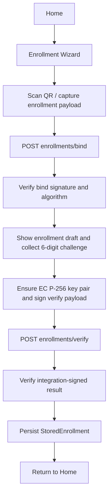
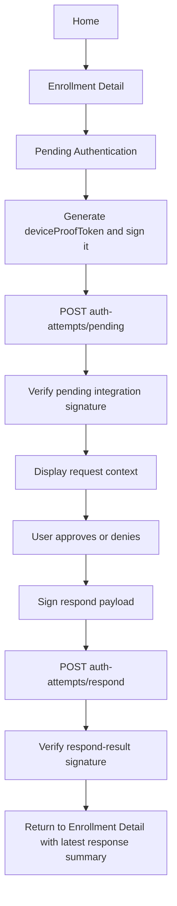

# Ezkey Mobile Functional Flows

## Purpose and Reading Scope

This document describes the two primary end-user processes implemented by the React Native reference app:
enrollment and authentication. It combines screen transitions, API calls, local mutations, and trust checks so the
reader can understand the mobile behavior end to end without reopening the source code.

Protocol semantics remain canonical in the root-level Auth API and signature payload documentation. This document is
the mobile operational view of those semantics. For the explicit finite-state model (guards, leave-as-deny,
duplicate-tap locks, TTL), see [MOBILE_APP_STATE_MACHINE.md](MOBILE_APP_STATE_MACHINE.md) (canonical; baseline
PR #833 @ `fcc31fbf`). Product/UX open questions and phased proposals:
[MOBILE_APP_STRATEGIC_ORIENTATION.md](MOBILE_APP_STRATEGIC_ORIENTATION.md). **Once Marc decides**, behavior
locks belong in the FSM and this flows doc; undecided items stay in the orientation note only.

## Flow Inventory and Notation

- `Nominal flow` means the intended successful path.
- `Exception flow` means a failure, empty, invalid, or terminal path the app must surface honestly.
- `Trust check` means a local verification step the app performs before trusting server-provided information.
- `Data mutation` means an in-memory draft, local persistent record, or UI state transition.

## Enrollment Nominal Flow

| Step | Screen | User/system action | API call | Data mutation | Trust check | Result |
| --- | --- | --- | --- | --- | --- | --- |
| 1 | Home | User taps `+` | None | None | None | Enrollment Wizard opens |
| 2 | Enrollment Wizard | User scans QR or enters bind payload | None | Bind form values captured | None | Enrollment payload available |
| 3 | Enrollment Wizard | Wizard starts bind | `POST /api/v1/enrollments/bind` | None yet | None before response | Bind response received |
| 4 | Enrollment Wizard | App validates bind result | None | `EnrollmentDraft` created in memory after validation | `integrationKeyAlgorithm == ed25519`; bind payload signature verified | Draft becomes trustworthy enough to display and replaces scan guidance with the verify step |
| 5 | Enrollment Wizard | User enters 6-digit challenge | None | Challenge input held in component state | Local length check | Verify can start |
| 6 | Enrollment Wizard | App ensures device key pair and prepares request | None | Device public key and storage tier derived locally | Device signs canonical verify payload | Verify request ready |
| 7 | Enrollment Wizard | Wizard submits verify | `POST /api/v1/enrollments/verify` | None yet | None before response | Verify response received |
| 8 | Enrollment Wizard | App validates verify result | None | Installation metadata may be fetched and assembled | Verify-result signature checked with stored integration public key | Enrollment completion becomes trustworthy |
| 9 | Enrollment Wizard | App persists record | Optional signed `POST /api/v1/enrollments/instance-info` | `StoredEnrollment` written locally | Integration signature verified before branding apply; host-only fallback if unavailable | Wizard clears state and returns to Home |

## Enrollment Exception Flow

| Exception case | Where it occurs | Technical meaning | User-visible handling | Recovery path |
| --- | --- | --- | --- | --- |
| Missing enrollment ID or proof token | Enrollment Wizard before bind | QR/manual payload incomplete | Bind error shown | Re-scan or re-enter payload |
| Missing Auth API URL | Enrollment Wizard before bind | No per-enrollment or global base URL available | Bind error shown | Use QR with `authUrl` or configure `EZKEY_API_BASE_URL` |
| Bind request failure | Enrollment Wizard | Backend or transport failure | Bind error shown | Retry bind |
| Unsupported `integrationKeyAlgorithm` | Enrollment Wizard after bind | App cannot trust the integration key semantics | Bind error shown; flow stops | None until contract aligns |
| Invalid bind signature | Enrollment Wizard after bind | Server identity cannot be trusted for this response | Bind error shown; flow stops | Retry from scan if appropriate |
| Missing or invalid challenge input | Enrollment Wizard before verify | Local input validation failure | Challenge error shown | Correct and retry |
| Verify request failure | Enrollment Wizard | Backend or transport failure | Challenge error shown | Retry verify |
| Invalid verify-result signature | Enrollment Wizard after verify | Enrollment completion cannot be trusted | Challenge error shown; no persistence | Retry from scan if necessary |
| Local persistence failure | Enrollment Wizard after verify | Enrollment could not be saved locally | Error surfaced; flow does not complete | Retry after storage issue is resolved |

## Authentication Nominal Flow

| Step | Screen | User/system action | API call | Data mutation | Trust check | Result |
| --- | --- | --- | --- | --- | --- | --- |
| 1 | Home | User selects an enrollment | None | Selected enrollment stored in navigation/store context | None | Detail screen opens |
| 2 | Enrollment Detail | User taps `Check pending` | None | Fresh `deviceProofToken` generated in memory and local last-verification timestamp updated | Device signs the proof token | Pending request can be sent |
| 3 | Enrollment Detail | App submits pending | `POST /api/v1/auth-attempts/pending` | None yet | None before response | Either request payload or empty result |
| 4 | Enrollment Detail | App validates pending result | None | `PendingAttempt` created in memory only if signature passes | Pending payload signature verified with stored integration public key | Stay on detail when empty; navigate to Pending Authentication when request exists |
| 5 | Pending Authentication | User reviews context and chooses approve or deny | None | User intent stored in component state | Local challenge presence check when required | Respond can start |
| 6 | Pending Authentication | App signs canonical respond payload | None | Respond signature prepared in memory | Protected mode asks for strong biometric or device-credential confirmation **on approve only**, then signs with the enrollment Keystore key. Deny and leave sign without that prompt (Question 11). Key use is not bound to that confirmation | Respond request ready |
| 7 | Pending Authentication | App submits respond | `POST /api/v1/auth-attempts/respond` | None yet | None before response | Respond result received |
| 8 | Pending Authentication | App validates respond result | None | Volatile local `RecentAuthResult` summary updated for this enrollment | Result signature verified with stored integration public key | App returns immediately to Enrollment Detail, which displays the latest response summary |

The phone does not show a remaining-time countdown. Ezkey does not push the attempt; the person
starts sign-in in the integrating application, whose SDK shows `expiresAt` from create/wait. That
is the clock they live with. They approve or deny here, or they cancel on that screen. A second
timer on the phone would repeat it and drift. The pending response does not gain an expiry field,
unsigned or inside the signed payload. Decided in
[MOBILE_APP_STRATEGIC_ORIENTATION.md](MOBILE_APP_STRATEGIC_ORIENTATION.md) (Questions 1 and 14, #834).

If `respond` returns HTTP 200 and the result signature is missing or invalid, the phone does not
show approved or denied and does not send another decision. The lock is set on that 200, before the
local check. The sentence says the response was sent, the confirmation could not be verified, and
to check the sign-in where it was started. It does not name a tenant. Back only. Decided in the
same note (Questions 2 and 9, #834).

If the `respond` response never arrives, the phone says the result is uncertain and to check the
sign-in where it was started. It does not say failure and it does not offer a retry that sends
another decision. Decided in the same note (Question 10, #834).

Approve in protected mode asks for biometric or device credential before signing. Deny and leaving
the screen sign the refusal without that prompt. Decided in the same note (Question 11, #834).

If the app is killed or backgrounded during `respond`, or the attempt lifetime ends during Approve
biometric, the row may stay `READ` until it expires. That window is an accepted limit. Applied
lifetime is **15–120 s** (default / ceiling **120**; #895). “120 seconds” means that default.
On Cloudflare Free, including the community instance, the proxy cuts the origin at 100 seconds
(HTTP 524); take that into account at deploy time. Decided in the same note (Question 12, #834).

The “decision already sent” lock follows `authAttemptId`, so a new attempt on the same screen is
not stuck behind the previous one (delivered with #833, merged 2026-10-16). Decided in the same
note (Question 13, #834).

If leaving the screen fails to send the refusal, the person still leaves. The phone shows one short
message and does not retry. They look back at the integrating application and either see a finished
sign-in or a countdown still running, which they let finish or cancel there. Decided in the same
note (Question 3, #834).

If the pending signature is missing or invalid, the phone does not show the request and does not
send a refusal. The server row may stay `READ` until the attempt expires. The person lets the
countdown finish on the integrating application, or cancels there. Decided in the same note
(Question 4, #834).

If `respond` returns **409** `auth-attempt-state-conflict`, the phone shows one sentence: the
request is no longer active. Back only. That type covers cancellation, already decided, superseded,
and related inactive causes (#844 m1). Wall-clock expiry after ownership proof returns **409**
`auth-attempt-expired` (#895); the phone **MAY** use distinct “expired” copy and still offers Back
only. Decided in the same note (Question 8, #834; amended #895).

While a request is on screen, a permanent line under Approve and Deny says that leaving declines
it. No confirmation dialog. Decided in the same note (Question 5, #834).

## Authentication Exception Flow

| Exception case | Where it occurs | Technical meaning | User-visible handling | Recovery path |
| --- | --- | --- | --- | --- |
| Enrollment missing locally | Pending Authentication before poll | Screen cannot target a valid enrollment | Error or missing state shown | Return to Home and reselect |
| Enrollment missing integration public key | Pending Authentication after API response | App cannot verify pending or respond signatures | Global error shown | Re-enroll or repair local record |
| Pending request failure | Pending Authentication | Backend or transport failure | Global error with retry | Tap `Try again` |
| No pending request | Enrollment Detail pending check | `204 No Content` / no usable pending body | User stays on Enrollment Detail with lightweight feedback | Tap `Check pending` again later |
| Invalid pending signature | Enrollment Detail pending check | Request context cannot be trusted; no attempt loaded | Stay on Detail. Plain copy: the request was not shown and will expire. No signature jargon. Do not send a refusal | Person lets the integrating-application countdown finish, or cancels there (Question 4) |
| Missing required 2-digit challenge | Pending Authentication before respond | Local validation failure | Inline form error shown | Enter code and retry |
| Respond request failure | Pending Authentication | Backend or transport failure | Global error shown | Retry if attempt still valid |
| Missing respond-result signature | Pending Authentication after respond | HTTP 200 already processed; outcome cannot be trusted | Stay; hide Approve/Deny; do not show approved or denied; do not send a second decision. Say to check the sign-in where it was started. No tenant name. Back only | Person checks that sign-in screen (Question 9) |
| Invalid respond-result signature | Pending Authentication after respond | HTTP 200 already processed; outcome cannot be trusted | Stay; hide Approve/Deny; do not show approved or denied; do not send a second decision. Say to check the sign-in where it was started. No tenant name. Back only | Person checks that sign-in screen (Question 9) |
| Verified failed result | Pending Authentication after respond | Attempt ended unsuccessfully | Detail screen shows the latest failed response summary | User can review it and start any future check from Enrollment Detail |
| Protected mode downgraded in Settings | Security screen | User tries to switch from protected mode to standard mode | No backend call | Preference would lower local protection | The app requires strong biometric or device-credential confirmation before saving the new value | Protection remains enabled if the user cancels |

## Local Rehydration Failure Flow (MOB-015)

Local storage or crypto failure — unreadable enrollment collection, missing secure secret, or a
sealed-secret envelope that fails to unseal — is a distinct exception family: nothing is wrong on
the server, only this device's copy is unusable. The design posture is fail-open visibility with
fail-closed authentication, and one plain-language user state ("unusable on this device") for
every internal cause.

| Exception case | Where it occurs | Technical meaning | User-visible handling | Recovery path |
| --- | --- | --- | --- | --- |
| Enrollment secret missing or unsealable | Home / Enrollment Detail rehydration | Proof token or integration key cannot be rehydrated for that row | Row stays visible with an "Unusable" badge and remove action; Detail shows the unusable state without `Check pending` | Remove the row, then re-enroll via a new QR from the administrator |
| All rows unusable | Home rehydration | Every persisted row failed secret rehydration | "Saved enrollment data is unusable" notice above the broken rows — never the first-use welcome | Remove rows individually or clear all data in the Danger Zone |
| Enrollment collection unreadable | Home rehydration | Collection JSON cannot be parsed; payload is kept on disk | Same "saved data unusable" notice with no rows | Danger Zone clear-all (true reset: also wipes orphaned secrets and the app seal key), then re-enroll |
| Dead app seal key after wipe | Danger Zone clear-all | A corrupted `ezkey_app_seal_v1` would poison future sealed secrets | None (internal guarantee) | Clear-all deletes the seal key so re-enrollment regenerates a fresh one |

Internal failure reasons are logged (and shown in `__DEV__` builds only); production copy never
exposes JSON, key, or unsealing vocabulary and never uses breach/compromise language. Provenance:
[campaign note](../../product-docs/global/hygiene/mobile-protocol-security/2026-07-19-pass-2.md);
model detail:
[MOBILE_DATA_MODEL.md § Enrollment Rehydration Outcomes](MOBILE_DATA_MODEL.md#enrollment-rehydration-outcomes-and-local-failure-honesty-mob-015).

## Screen Transition Tables

| Event | Source screen | Destination screen | Condition |
| --- | --- | --- | --- |
| Tap add enrollment | Home | Enrollment Wizard | Always available |
| Successful enrollment persistence | Enrollment Wizard | Home | Verify-result signature accepted and storage write succeeds |
| Cancel wizard | Enrollment Wizard | Home or previous state | User cancels while not submitting |
| Select enrollment | Home | Enrollment Detail | Enrollment exists locally |
| Tap `Check pending` | Enrollment Detail | Pending Authentication | Enrollment exists locally |
| Respond approved / denied / failed | Pending Authentication | Enrollment Detail | Trusted respond result received and summarized on the detail screen |
| Retry load/error state | Pending Authentication | Pending Authentication | User taps retry while still resolving the current request |

## Data Mutation Tables

| Flow step | Data created | Data updated | Data retained | Data cleared |
| --- | --- | --- | --- | --- |
| Bind success | `EnrollmentDraft` | Bind form state | None | Prior draft/error state |
| Verify request preparation | Device public key/signature in memory | Challenge state | Draft | None |
| Verify success | `StoredEnrollment` local record | Installation metadata snapshot | Integration public key, proof token, auth URL | Draft and challenge state |
| Pending request preparation | Fresh `deviceProofToken` and signature | Debug/loading state and local last-verification timestamp | Persisted enrollment record | Prior global error |
| Pending success | `PendingAttempt` in memory | Challenge-required UI state | Persisted enrollment record | Empty/error state |
| Respond success | Result UI state | Challenge failure or result message state | Persisted enrollment record | `PendingAttempt` may be cleared on failed outcomes |

## Trust-Check Sequence Tables

| Step | Artifact checked | Verification type | Failure effect |
| --- | --- | --- | --- |
| Bind response acceptance | `integrationKeyAlgorithm` | Fail-closed algorithm tag check | Bind response rejected |
| Bind response acceptance | `enrollmentBindPayloadSignedByIntegration` | Ed25519 verification with `integrationPublicKey` | Bind response rejected |
| Verify request preparation | Canonical verify device payload | Device ECDSA signature generation | Verify cannot proceed |
| Verify response acceptance | `enrollmentVerifyPayloadSignedByIntegration` | Ed25519 verification with stored integration public key | Enrollment not persisted |
| Pending response acceptance | `authAttemptProofTokenSignedByIntegration` | Ed25519 verification with stored integration public key | Pending attempt not displayed |
| Respond request preparation | Canonical respond payload | Device ECDSA signature generation | Respond cannot proceed |
| Security preference downgrade | Local preference change from protected to standard | Android device confirmation (`BIOMETRIC_STRONG | DEVICE_CREDENTIAL`) | Preference is not downgraded |
| Respond response acceptance | `authAttemptProofTokenResultSignedByIntegration` | Ed25519 verification with stored integration public key | Outcome not trusted or displayed |

## Known Deviations and Deferred Paths

- The current implementation exposes a `DangerZone` screen for destructive local actions even though the original mobile PRD framed v1 as read-only for destructive management.
- Enrollment Detail currently focuses on identity and the `Check pending` action; a dedicated history placeholder is not yet present.
- Pending and respond outcomes are not currently persisted as a rich local activity history.
- Home does not offer direct pending polling; the intentional path still goes through Enrollment Detail to preserve the user-driven posture.
