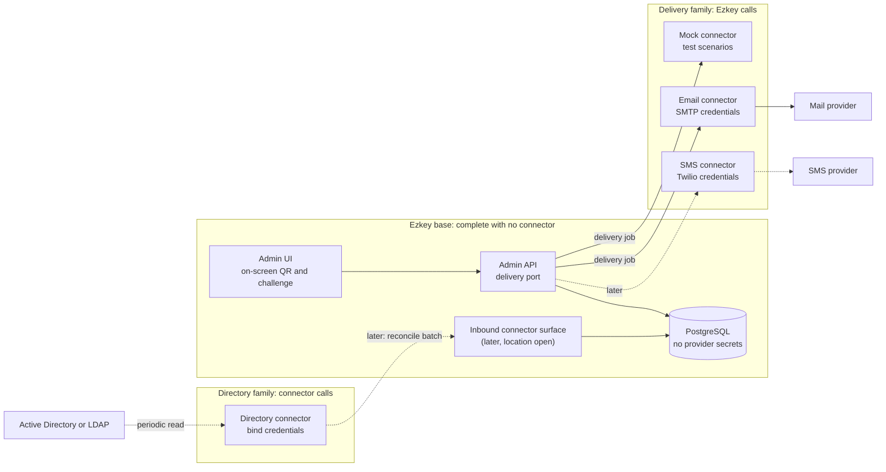
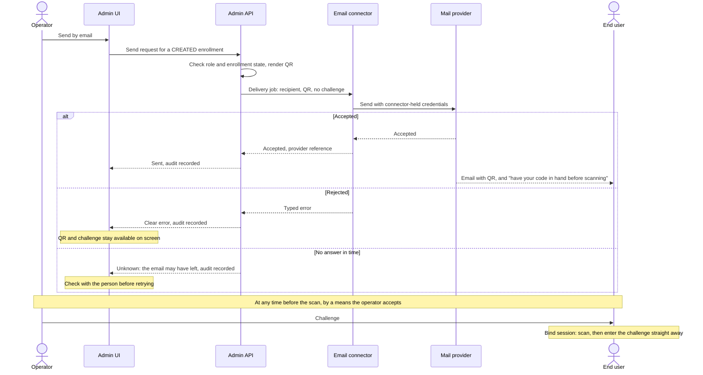
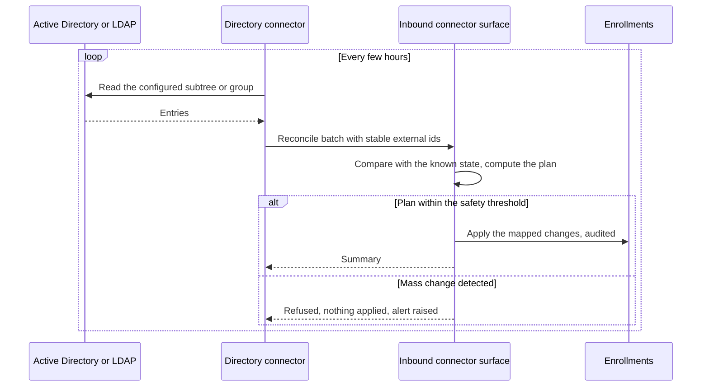
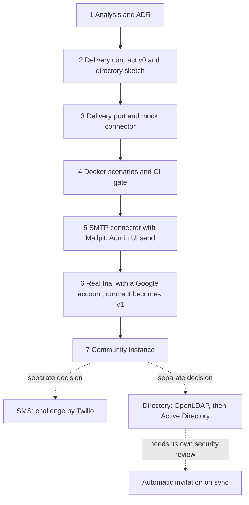

# Decision pack — Connector SPI for external services

## Metadata

- **Date:** 2026-11-04
- **Status:** accepted direction; ADR-0018 accepted by Marc on 2026-11-05 after [critical review](../../hygiene/critical-review/2026-11-05-pr1209-connector-spi.md). Step 2 carries the open questions below
- **Scope:** how optional external services (email, SMS, directories) connect to an Ezkey base
- **Related ADR:** [ADR-0018](../../architecture-decisions.md#adr-0018--connector-spi-for-external-services)
- **Vision:** [`V-2026-11-04-connector-spi`](../../vision/V-2026-11-04-connector-spi.md)
- **GitHub:** [#1206](https://github.com/mgagp/ezkey/issues/1206) (program), [#1207](https://github.com/mgagp/ezkey/issues/1207) (this step)
- **Captured by:** Marc
- **Non-goals of this pack:** the OpenAPI contract (step 2), any code, a generic plugin framework

## The short version

1. **A connector is a separate process that talks to Ezkey over versioned HTTP.** Ezkey runs fully
   without one; on-screen QR and challenge stay a valid posture.
2. **Two families flow in opposite directions.** Ezkey calls a delivery connector when an operator
   sends. A directory connector calls Ezkey on its own schedule.
3. **Provider secrets stay in the connector.** Ezkey never holds a Twilio token, an SMTP password or
   a directory bind password.
4. **One message never carries both factors.** Email carries the QR. The challenge stays on screen,
   or goes by SMS later. An admin activation code equals both factors, so it never goes through a
   connector.
5. **Build the mechanism with a mock first,** then email, then the community instance. SMS and
   directory follow as separate decisions.

## Concepts

Audit archive export ([`V-2026-06-28`](../../vision/V-2026-06-28-audit-archive-export-spi.md)) follows
the same principle but stays deferred. It is not folded into this work.

### What the families share, and what they do not

**Shared conventions:** optional by configuration, versioned HTTP contract, per-connector credential,
health and capability check, provider secrets outside Ezkey, audit of the actions Ezkey takes, no
vendor SDK in the core.

**Not shared:** payloads, direction and failure posture. Each family gets its own small contract.
A generic plugin framework would be accidental complexity for two families (principles #2 and #14).

### Terminology

Use **connector** for the running component. In this codebase, *integration* already means a domain
entity and *peripheral* appears in the audit heartbeat wording
([`docs/ECOSYSTEM_REPOSITORIES.md`](../../../../docs/ECOSYSTEM_REPOSITORIES.md)). **SPI** names the
contract here, not Java's `ServiceLoader`.

## Two delivery modes, one bind session

Ezkey has two operating modes: **integrated delivery**, with no dependency, and
**connector-assisted delivery**, in whatever form. A connector can send the QR by email while the
challenge stays on screen; the operator then passes the challenge on by any means they accept: a
phone call, or an SMS from their own phone. Boundaries without dogmatism.

Whatever the mode, **scanning starts a sequence**: the person must have both items in hand before
scanning. They may receive them days apart, so Ezkey never synchronizes channels or connectors. The
rule lives in `ezkey_mobile/docs/MOBILE_APP_STATE_MACHINE.md` § *Product intent: one bind session*.

## Flow: send the QR by email

"Accepted" means the provider took the message, not that the user received it. The email is not
something to act on later without the code: leaving after the scan requires a new invitation.

After a send, the Admin UI says what comes next: "QR sent. Give this person the code before they scan."
Otherwise an operator can believe the work is done once the email leaves.

## Flow: directory reconcile (later)

The connector only opens outbound connections. It can sit inside the company network, and Ezkey never
receives directory credentials. Duo's on-premises directory sync relies on a similar local proxy.

### Mapping directory state to the enrollment lifecycle

Checked against [`docs/LIFECYCLE_GOVERNANCE.md`](../../../../docs/LIFECYCLE_GOVERNANCE.md) § 3.3 and the
revocation code (`EnrollmentRevocationService`).

| Directory event | Enrollment state | Proposed effect | Note |
|-----------------|------------------|-----------------|------|
| New entry in scope | None | Create a `CREATED` enrollment | Sending the invitation needs a later auto-send decision |
| Account disabled | `VERIFIED` + active | Deactivate | Reversible; a disabled account may come back |
| Account re-enabled | `VERIFIED` + inactive | Reactivate **only if the connector deactivated it** | An operator's investigation hold must survive |
| Removed | `VERIFIED` + active | Deactivate at once | A leaver must not keep access during the grace period |
| Removed, past a grace period | `VERIFIED` | Revoke with a reason | Governance: revoke when the user has left |
| Removed or disabled | `CREATED` or `BOUND` | Revoke | Revoke refuses only an already `REVOKED` enrollment; deactivating a pending one does nothing, since it is not yet active |
| Any | Admin MFA enrollment | **Never touched** | Prevents locking administrators out |

**Safety rails, all required before a real directory:** a dry-run preview, a threshold that refuses a
mass change (a wrong filter or an empty read must not deactivate everyone), and an alert when the
connector goes silent, because leavers then stay active.

## Options for the exchange mechanism

Marc asked whether exchanges go through the database, a message queue or a REST surface. The
2026-05-19 SMS decisions chose an HTTP adapter for delivery. The directory family is the new signal
that justified looking again.

| Option | Delivery | Directory | Verdict |
|--------|----------|-----------|---------|
| **REST, direction chosen per family** | Immediate error for the operator | Outbound-only from the customer network | **Retained** |
| Shared application schema | Polling; no immediate error | Connector needs database access from the customer network | Rejected: couples connectors to the schema |
| Dedicated exchange table with a restricted role | Polling; job waits if the connector is down; no immediate error | Would expose PostgreSQL to the customer network | Not retained for now: see below |
| Outbox inside the core, then REST to the connector | Durable, same connector contract | Not applicable | In reserve for automatic sending: see below |
| Message queue | Needs a result channel for the error | Works, but crosses the network boundary | Rejected: new infrastructure for an SME, against principle #7. Reopen on real volume |
| In-process plugin | Immediate | Would put directory access inside the API | Rejected: vendor SDKs and secrets in the API process, image rebuilds |
| Connector polls Ezkey for delivery jobs | Works behind NAT | Same direction as directory | Rejected for now: needs a stored job, which means stored secret material |

Email in the core (the earlier `V-2026-0005` stance) was also set aside: simpler to deploy, but it
would leave two models and would not test the SPI on a real case (Marc, 2026-11-04).

### Dedicated exchange table: considered, not retained (Marc, 2026-11-06)

Marc proposed a middle path he had seen work elsewhere: one table used as a message queue, reached by a
role limited to that table, so that transactions stay database transactions with no two-phase commit.

**What holds.** The security objection was overstated: Ezkey already runs separate PostgreSQL roles with a
grant matrix (`docs/DATABASE_ROLE_PERMISSIONS_MATRIX.md`), so a restricted role or a separate schema is a
small cost. The real gains are also clear: no outbound HTTP client in the core, no call timeouts or pool
risk, and a job that survives a connector outage.

**What blocks it.** The QR carries the proof token, a bearer secret until bind, stored encrypted with a key
only the core can use. A job the connector can read must therefore take one of three forms:

- **QR in clear:** a second copy of a live secret, also present in backups.
- **Encrypted for the connector:** key management and rotation per connector.
- **A reference only:** the connector calls back to fetch the QR, so REST returns.

| Case | REST | Exchange table with polling |
|------|------|-----------------------------|
| Connector down at the click | Immediate error; the operator retries | Job waits |
| Outbound client, timeouts, pool | To build and test | Gone from the core |
| Error shown to the operator | In the response | Needs status tracking in the Admin UI |
| Revoked while waiting | No such window | Jobs must be cancelled, or a revoked QR still leaves |
| Connector dies during the send | `unknown` | `unknown`, plus a lease and a cleanup |
| State to manage | Three outcomes, nothing persisted | Five or six states, lease, heartbeat, expiry, purge |
| Compromised connector | No database access | A PostgreSQL login and all pending jobs |
| Contract change | Versioned OpenAPI | A core migration coordinated with each connector |

The table makes the link between Ezkey and the queue transactional, but not the link between the connector
and the mail provider, so `unknown` remains. The main benefit of the pattern, writing a business change
and its message in one transaction, is mostly unused here: an operator's send changes no enrollment
state. `ezkey_integrity_async_job` shows the machinery such a table needs in this codebase.

**Variants.**

- **A thin API as a trigger:** a lost trigger still requires polling the table, so this keeps two channels.
- **No API, with `NOTIFY` and triggers:** `NOTIFY` delivers nothing to a disconnected listener and does not
  carry the data, so polling is still needed. Triggers add hidden logic to migrate and test. At SME volume,
  plain polling every few seconds would be enough.
- **Directory family:** the connector lives in the customer network, and PostgreSQL should not be exposed
  there. This family stays on outbound HTTP, so a table would mean two models.

**Reopen on automatic sending,** for example an invitation created by directory sync. No operator is then
present to retry, and writing the enrollment and its message in one transaction becomes valuable. Start
from an outbox inside the core: it is close to this proposal, keeps the REST contract with connectors, and
needs the "no stored job" invariant reopened explicitly.

## Secrets and parameters

| Item | Lives in | Set by |
|------|----------|--------|
| Provider credentials (SMTP, Twilio, directory bind) | Connector environment or Docker secrets | Whoever deploys the connector |
| Connector settings (sender, search base, schedule) | Connector configuration | Same |
| Connector URL and credential for Ezkey to call it | Ezkey configuration: properties first, a table with the existing encryption if an Admin UI screen is added | Global Admin |
| Inbound credential for a directory connector | Ezkey, stored hashed like API keys; its scope is an open question for the directory phase | Global Admin |

**Cost of this choice:** the operator configures two places, and provider secrets cannot be typed into
the Admin UI. **Benefit:** no secret vault to build, and a compromised Ezkey database reveals no
provider credential. **Limit:** a stolen connector credential reveals no provider secret, but it can
still send as the organisation until rotated.

## Security invariants

1. **One message, one factor.** The core refuses a job that combines the QR and the challenge, and any
   job carrying an admin activation code, which alone yields both factors. This is a rule in the core,
   not a connector convention.
2. **Send only while `CREATED`.** The proof token is a bearer secret until bind. The challenge is not
   sent, and stays readable by the operator while `CREATED` or `BOUND`, because verify runs at `BOUND`
   (Marc, 2026-11-05). This corrects the rule proposed in
   [#1180](https://github.com/mgagp/ezkey/issues/1180), still open.
3. **No stored job.** The send is synchronous and operator-triggered, so no outbox holds secret
   material. A later auto-send decision must reopen this explicitly.
4. **Nothing sensitive in logs on the send path,** on either side, including connector debug logs.
   Bootstrap is a separate matter: it logs its token by design in `full` mode
   ([#1223](https://github.com/mgagp/ezkey/issues/1223)). See *Proving it on real output* below.
5. **The connector keeps nothing.** It holds the material only for the duration of the send.
6. **Transport:** a private Docker network or TLS, plus an authenticated caller. Step 2 picks the
   scheme.

**Proving it on real output (Marc, 2026-11-05).** The QR travels as a base64 PNG, so searching logs for
the token would pass even if a whole request body were logged. Log-capture unit tests do not see a library
debug mode switched on by configuration either. So:

- **A canary test at the step 4 gate:** send with a recognizable token and recipient, after bootstrap,
  then search `docker logs` of all containers.
- **It looks for shapes as well as values:** long base64 blocks, the PNG signature `iVBORw0KGgo`, and
  request bodies.
- **Errors use typed codes,** never message text, and provider text is not logged as is.
- **`LogSanitizer`** on the recipient, names and any provider text.
- **SMTP debug refuses to start** outside an explicit test mode (step 5).

This shows known shapes are absent in the scenarios played. It does not prove that no rare error path
leaks.

**Exposure that remains, stated honestly:** the QR sits in a mailbox and at the mail provider. Read-once
bind, the invitation window and the separate one-shot challenge bound the risk; the token also outlives
the invitation as a low-impact identifier
([`I-2026-11-03`](../../backlog/ideas/I-2026-11-03-enrollment-invitation-links.md)). Mail gateways may
also strip or flag images.

**QR phishing, a residual risk made more credible by this feature.** Routine QR emails teach people to
scan what they receive. An attacker can run their own instance and send a QR and challenge imitating the
real message. The victim then enrolls a device with the attacker. This gives no access to the victim's
real enrollments or accounts, but it opens a credible approval channel to their phone for social
engineering. The app contacts the server at scan, the HTTPS policy proves transport and not identity,
and the labels on screen come from that same instance.

**Mitigation (Marc, 2026-11-05):** show the server host at the challenge step, before the person
completes enrollment, as a precondition for step 7 (tracked on
[#1185](https://github.com/mgagp/ezkey/issues/1185)). The email states the expected server so the person
can compare. Many people will not read it, so this reduces the risk without removing it. A review step
before bind stays with the invitation links program, where opening a link must not contact a server
without a decision.

## Abuse limits on sending

A send path can become a mail relay, above all on the public community instance, where anonymous
signup creates a real tenant and `contact_email` carries no proof of ownership (Marc, 2026-11-05).

- **Fixed template:** the contract has no free subject or body.
- **Evaluator temporary sessions are denied.** `EvaluatorTempAccessFilter` is a deny-list, so a new
  route is open until listed.
- **Daily caps** per tenant and per instance, on every installation.
- **No sending for self-registered tenants on the community instance.** They keep integrated delivery.
  Open it later if evaluators ask. Nothing marks such a tenant today, so this needs a small addition.

## Failure postures (principle #17)

| Situation | Posture | Behavior |
|-----------|---------|----------|
| Delivery connector absent | Fail-open | Integrated delivery; no send button |
| Send rejected | Fail-open, visible | Clear error, audit entry, on-screen material stays available |
| No answer in time | Fail-open, visible | Outcome `unknown`, never "failed": the provider may have accepted. Audit says so, on-screen material stays available |
| Directory connector silent | Fail-open, visible | Nothing changes; staleness alert |
| Directory read looks wrong | Fail-closed | Mass change refused, nothing applied, alert |
| Connector credential rejected | Fail-closed | Call refused and logged |

Ezkey makes one attempt per operator click; retries remain the operator's choice.

**The call itself (Marc, 2026-11-05).** This would be the first outbound HTTP client in the Ezkey APIs, so
its behavior is defined here:

- **Three outcomes** in the contract, the UI and the audit: `accepted`, `rejected`, `unknown`.
- **A send id per click,** passed to the connector, links the logs on both sides. It is for traceability
  only: a duplicate of the same QR is harmless, and deduplication would make the connector keep state.
- **Explicit connect and read timeouts,** well under Cloudflare Free's 100 s limit.
- **The call runs outside any transaction,** and a test with a deliberately slow mock checks the database
  pool, because `open-in-view` stays on in the Admin API.

## Impact by step

| Surface | Steps 3–5 (delivery) | Later (directory) |
|---------|----------------------|-------------------|
| **Database** | None expected beyond audit entries; connector settings start as properties | External source and stable id on enrollments; a non-admin actor, because `*_by_admin_id` columns assume a person; sync run history |
| **Admin API** | Send endpoint, capability read for the UI | None: the machine-to-machine hatch stays removed (`I-2026-08-29`) |
| **Admin UI** | Send button, error, updated integrated-delivery copy | Sync status, dry-run review |
| **Connector contract** | Delivery job, health and capabilities | Reconcile batch and result |
| **Inbound surface** | None | New, location open (see below) |
| **Operations** | Compose profile, `CONFIGURATION.md` | Deployment guide for the customer network |
| **CI** | Mock scenarios and a path-filtered job | OpenLDAP scenarios |

## Evolution

The mock connector is the long-term test tool as well as the first step: it plays success, provider
error, timeout and rejected credential, so CI, QA and new connector prototypes share one fixture.

## Open questions for step 2

1. **Authentication** between Ezkey and a delivery connector: decided, bearer token per connector
   ([`TB-2026-11-06`](../../backlog/TB-2026-11-06-connector-delivery-contract-v0.md)).
2. **QR format in the job:** decided, a PNG in base64 rendered by the core (same brief).
3. **Recipient:** decided, the enrollment's `contactEmail` only, present at send time (same brief).
4. **Audit:** decided, the full address in the audit entry, never in application logs (same brief).
5. **Email wording and locale:** the message must tell the person to have the code in hand before
   scanning, and state the expected server. Who owns the template?
6. **What the health check returns.**

**Requirements already set for step 2 (Marc, 2026-11-05):**

- **The contract stays `v0` until the real trial at step 6,** and can change without compatibility work.
  It becomes `v1` after that trial. The step order stays: the mock and its gate come first, because they
  make the rest safe to build, and all the code lives in the monorepo.
- **The job carries** the trigger (operator today), the template and locale, and the tenant. An
  asynchronous result and bulk sending wait until a real need appears.
- **The directory sketch fits on one page,** limited to what could force a change to the delivery contract.
  Size it for SME volumes (`product-intent.md` § *Scale and positioning compass*).
- **The mock cannot pass for real delivery:** it refuses to start outside an explicit test mode and
  identifies itself in its responses.
- **The CI job stays thin** and path-filtered, like `ezkey-jenkins`.

## Open questions for the directory phase

1. Where the inbound surface lives: a dedicated module, or a separate path on the Integration API,
   which is today's only machine-to-machine boundary. Not the Admin API.
2. A directory-shaped API, or one aligned with SCIM, which Microsoft Entra ID can push natively.
3. How a directory scope maps to tenant and integration, since an enrollment belongs to one integration.
4. **Operator hold:** "reactivate only if the connector deactivated it" fails when the connector acts
   first, since the operator's deactivate is then a no-op that records nothing. A hold needs its own marker.
5. **"None" in the mapping table:** a person whose enrollment was `REVOKED`, `EXPIRED` or `INVALID` must not
   automatically get a new invitation, or a compromise revocation is undone.
6. **False departure:** moving someone out of the subtree looks like a removal, and revoke is irreversible.
7. **An admin who left:** "never touched" stays right, but it needs an alert so they do not stay active
   silently.
8. **A returning person:** an inactive `VERIFIED` enrollment with the same name makes verify fail at the
   last step.
9. **Revoke after the grace period:** automatic, or confirmed by an operator?

## Interactions to watch

- **Invitation links** ([`I-2026-11-03`](../../backlog/ideas/I-2026-11-03-enrollment-invitation-links.md),
  [#1185](https://github.com/mgagp/ezkey/issues/1185)): a QR in an email cannot be scanned from the
  phone reading that email. A link would solve that later, so the delivery job should leave room for it.
- **Exposure rule** ([#1180](https://github.com/mgagp/ezkey/issues/1180)): the send path follows its proof token rule; its challenge rule needs the correction in invariant 2. At `BOUND`, the operator screen should say a device has already scanned and remind them to confirm who they are speaking to.
- **Burning an invitation** ([#1024](https://github.com/mgagp/ezkey/issues/1024)): an unauthenticated verify
  can invalidate a pending enrollment, and email lengthens how long a QR waits. Fixed on its own track,
  promptly, whatever the state of this program (Marc, 2026-11-05).
- **Later, no decision yet:** a shorter window after bind on the server, and a simpler recovery after
  an abandoned bind than delete and recreate.

## To verify when the step arrives

- **Step 6:** Google's current terms, limits and authentication options for sending from a dedicated
  account. A personal mailbox is not assumed to suit the public instance.
- **Step 7:** outbound port rules on Lightsail, sender-domain authentication (SPF, DKIM) for
  deliverability, and the abuse limits above.
